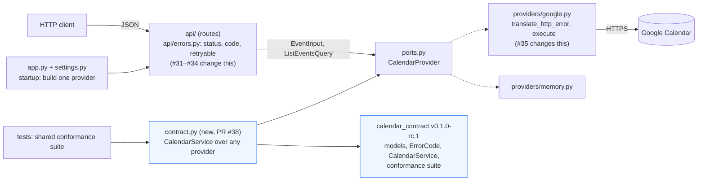
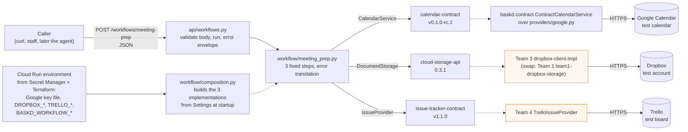

# DESIGN: BASK'D on the shared Calendar contract

| | |
| --- | --- |
| **Authors** | Arda Dinc (draft), for Team 7; implementation record (§12) by Karthik Ganeshan |
| **Team and vertical** | Team 7 (Sam Fiallos, Arda Dinc, Bryant Luna-Ramos, Karthik Ganeshan, Daniel Zhang), Calendar vertical with Teams 2 and 5 |
| **Reviewers** | Whole design: Sam Fiallos and Karthik Ganeshan (Team 7). Contract-facing parts (§3, §4, §6, §8): Alexander Freedman and Leon Liu (Team 2). See [§10](#10-review-record) |
| **Status** | **Implemented** in `v0.2.0`. Approved by Team 7 on Nov 4; what changed while building it is in [§12](#12-what-changed-during-implementation) |
| **Last updated** | 2026-11-11 |
| **Shared contract** | [`calendar-contract` `v0.1.0-rc.1`](https://github.com/Airbus-A330/OSPSD-Calendar/tree/v0.1.0-rc.1) (commit `1c1cad7`): [HTTP contract](https://github.com/Airbus-A330/OSPSD-Calendar/blob/v0.1.0-rc.1/docs/HTTP_CONTRACT.md), [Python interface](https://github.com/Airbus-A330/OSPSD-Calendar/blob/v0.1.0-rc.1/docs/PYTHON_INTERFACE.md), [conformance suite](https://github.com/Airbus-A330/OSPSD-Calendar/blob/v0.1.0-rc.1/src/calendar_contract/conformance.py) |
| **Decision memo** | "Calendar API: joint contract (Teams 2, 5, 7)", version 4, agreed Oct 28, 2026. It is a Google Doc whose link lets anyone edit, so it is not linked from this public repository; its rules are restated, with the memo's rule numbers, in the shared repo's HTTP contract above |
| **Implementation work** | [#37](https://github.com/samthropic/BASKD/issues/37) / [PR #38](https://github.com/samthropic/BASKD/pull/38) (adopt the package, run its suite), [#31](https://github.com/samthropic/BASKD/issues/31) / [PR #36](https://github.com/samthropic/BASKD/pull/36) (shared error codes), [#32](https://github.com/samthropic/BASKD/issues/32) / [PR #56](https://github.com/samthropic/BASKD/pull/56), [#33](https://github.com/samthropic/BASKD/issues/33) / [PR #41](https://github.com/samthropic/BASKD/pull/41), [#34](https://github.com/samthropic/BASKD/issues/34) / [PR #54](https://github.com/samthropic/BASKD/pull/54), [#35](https://github.com/samthropic/BASKD/issues/35) / [PR #48](https://github.com/samthropic/BASKD/pull/48). Milestone 3 infrastructure: [PR #49](https://github.com/samthropic/BASKD/pull/49), [#50](https://github.com/samthropic/BASKD/pull/50), [#52](https://github.com/samthropic/BASKD/pull/52), [#53](https://github.com/samthropic/BASKD/pull/53), [#55](https://github.com/samthropic/BASKD/pull/55), [#57](https://github.com/samthropic/BASKD/pull/57). Release [`v0.2.0`](https://github.com/samthropic/BASKD/releases/tag/v0.2.0) |

This document says how our HW1 service, BASK'D, will satisfy the contract the three Calendar
teams agreed on, and how we will know it does. It does not repeat the contract: when a rule is
cited as "rule N", the wording is in the shared HTTP contract.

HW3 adds one composed workflow across Calendar, Storage and Issue Tracker. It is
described in [HW3 Milestone 1](#hw3-milestone-1-composing-the-three-verticals), after §12.

## 1. Context, goals and non-goals

**What a consumer wants.** A client (a script, another team's app, the course staff's checker)
wants to create, read, replace and delete events through any of the three Calendar services
with one piece of code: the same request bodies, and the same decision about what to do when
a call fails.

**Why that is hard today.** BASK'D `v0.1.0` agrees with the contract on paths, field names and
success statuses, but not on failures, and the differences are silent:

- **A timed-out create.** When Google does not answer an `events.insert` within our timeout, we
  return `503 provider_unavailable` with `Retry-After: 5`. A client written for the contract
  reads 503 as "temporarily unavailable, try again", resends the `POST`, and can create a
  second copy of the event, because Google may have stored the first one. Rule 6 makes this
  case `502 provider_error` with `"retryable": false`. Nothing in our response tells the client
  otherwise: we do not send `retryable` at all (rule 4).
- **Error codes.** A client that branches on `code == "not_found"` never matches our
  `event_not_found`, and falls into its "unknown error" path for an ordinary missing event.
  Likewise `validation_error` and `invalid_request` versus `invalid_input` (rule 12).
- **A calendar the service cannot see.** We return `502 provider_auth_error`. A client that
  retries 5xx responses keeps retrying a configuration problem that only an operator can fix;
  the contract says `403 access_denied` (rule 9).
- **A body that is not JSON** gets our `422`; the contract says `400` (rule 3), so a client
  cannot tell its own serialisation bug from a rule it broke.

**Goals.** Each is observable from outside the service:

1. A client that uses only the shared four fields and branches only on `code` and `retryable`
   completes create → get → replace → delete against BASK'D with the same code it uses for
   Teams 2 and 5 ([§8](#8-testing), consumer workflow).
2. Every error body has `code`, `message` and `retryable`, and every failure the contract
   covers carries one of the five shared codes with the status the contract gives it.
3. A create or replace whose outcome is unknown is never reported as retryable, and the
   service never resends it on its own.
4. The package's conformance suite passes against BASK'D in every CI run, and its create, get,
   replace and delete checks pass against the real Google Calendar.
5. Our extensions keep working: listing with a window and cursor, `description`, `location`,
   the read-only `all_day` and `web_link`, and the `Location` header on create.

**Non-goals.**

- Making listing, `PATCH`, all-day events or fields beyond the shared four part of the shared
  contract (memo open question 3). They stay our documented extensions.
- Idempotent create. We raise the problem (memo open question 2, [§9](#9-open-questions)) but
  do not build it this milestone.
- Building our HTTP handlers on the shared Python models ([§5](#5-alternatives-and-tradeoffs)).
- Multiple calendars, caller identities, attendees, or moving events between calendars or
  providers. The service stays bound to one configured calendar.

## 2. Proposed architecture and request flow

The design changes two edges of the existing ports-and-adapters layout and adds one adapter.
The core (`ports.py`, `models.py`, the in-memory provider) does not change. The module-by-module
tour is in [`docs/ARCHITECTURE.md`](docs/ARCHITECTURE.md).



| Responsibility | Where | Changes in this design |
| --- | --- | --- |
| Shared contract package: shared models, the five codes, `CalendarService`, the conformance suite | `calendar_contract` (git dependency, pinned to a tag) | New dependency (PR #38) |
| Request validation (rules 2, 7, 13, 14) | `models.py` (`EventInput`, `ListEventsQuery`) | None: already follows the rules |
| HTTP translation: status, error code, `retryable`, `Retry-After`, failure log line | `api/errors.py` | Codes (#31), 403 (#32), `retryable` (#33), 400 for non-JSON (#34) |
| Application decisions (refuse to replace an all-day event or a recurring series) | `providers/google.py::replace_event` | None |
| Provider adapter: Google calls, timeout, Google error → domain error | `providers/google.py` | A write that may have happened becomes `ProviderError` (#35) |
| Domain errors (class, code, `retryable`) | `errors.py` | Codes renamed (#31) |
| Shared Python interface over our providers | `contract.py` | New (PR #38) |
| Startup configuration | `settings.py`, `providers/__init__.py::build_provider`, `app.py::create_app` | None |

**Who owns state and clients.** `create_app` builds one provider at startup from
`Settings` and keeps it on `app.state`; handlers get it through `api/dependencies.py`. The
Google provider holds the service-account credentials and the SDK's service object for the
life of the process. Each call opens its own `httplib2.Http` with the configured timeout
(`BASKD_GOOGLE_TIMEOUT_SECONDS`, default 10 s), so no connection outlives a request and there
is nothing to close at shutdown. The service keeps no event data of its own: Google is the
only store.

**Where things happen.** Validation happens once, at the boundary, in `models.py`. Domain
conversion (Google resource ↔ `Event`) is in `providers/google.py`. Error translation happens
twice, deliberately: Google → domain errors in the provider, domain errors → HTTP in
`api/errors.py` (or → shared `CalendarError` in `contract.py`). Logging happens only on failure:
one sanitised line from `api/failure_log.py` per failed request, plus one line from the Google
adapter with Google's status and `reason` codes.

**Trace 1, success: `POST /events`.**

1. FastAPI decodes the JSON body into `EventInput`. It rejects missing, `null` and unknown fields,
   timestamps without an offset, numbers, blank titles, titles over 1024 characters and an `end`
   not after `start` once sub-seconds are dropped, all with `422` and before any provider call.
2. `api/events.py::create_event` calls `provider.create_event(data)` on the `CalendarProvider`
   from `app.state`.
3. `GoogleCalendarProvider.create_event` builds the body (`to_google_body`) and runs one
   `events.insert` through `_execute` (no SDK retries: `num_retries=0`).
4. `event_from_google` turns Google's resource into an `Event` with UTC times.
5. The handler returns `201`, a `Location: /events/{id}` header and the event. Nothing is logged.

**Trace 2, expected failure: `POST /events` while Google times out, after #35.**

1–3. As above, until `events.insert` raises a socket timeout inside `_execute`.
4. Because the call is a write, `_execute` raises `ProviderError("…outcome unknown…")` instead
   of `ProviderUnavailable`. (Today it raises `ProviderUnavailable`.)
5. `api/errors.py` maps `ProviderError` to `502` with
   `{"error": {"code": "provider_error", "message": "…", "retryable": false}}` and no
   `Retry-After`. `failure_log.py` writes one `ERROR` line with the operation, status, code,
   `retryable` and request id, and no body, event id or Google text.
6. The client sees `retryable: false` and does not resend blindly ([§8](#8-testing)).

The Python path is the same, with `contract.py` in place of the handler:
`ContractCalendarService.create(CreateEvent)` validates the shared request into our
`EventInput` (so our own limits apply), calls the provider, and converts the result to the
shared `Event`. A domain error is re-raised as the shared `CalendarError` with the same message
and `retryable`.

## 3. API and data model

The authoritative contracts are the shared
[HTTP contract](https://github.com/Airbus-A330/OSPSD-Calendar/blob/v0.1.0-rc.1/docs/HTTP_CONTRACT.md)
and [Python interface](https://github.com/Airbus-A330/OSPSD-Calendar/blob/v0.1.0-rc.1/docs/PYTHON_INTERFACE.md).
Our own API is in the [README](README.md#the-api). The choices that matter:

- **Identifiers.** Google assigns the event id. It is opaque, 1–1024 characters, and scoped to
  the one calendar the service is configured with; clients never name a calendar.
- **Fields.** `title`, `start` and `end` are required on create and replace. `description` and
  `location` are optional extensions. `all_day` and `web_link` are read-only extensions.
- **Replace.** `PUT` replaces every client-editable field: the shared three, and our
  `description` and `location`, which are cleared when omitted (rule 1 leaves this to each
  team). The id never changes.
- **Times.** Requests: RFC 3339 with an offset. Responses: UTC with `Z`. Sub-seconds are dropped
  before `end > start` is checked (rule 14).
- **Failures.** The table in [§4](#4-failure-behaviour-and-operational-concerns).

**Illustrative expected exchange (after `v0.2.0`).** The success shape is what `v0.1.0`
already returns, and recorded runs are in [`TUTORIAL.md`](TUTORIAL.md). The error body is
expected, not yet observed.

```http
POST /events
Content-Type: application/json

{"title": "Team sync", "start": "2026-11-11T10:00:00-05:00", "end": "2026-11-11T10:30:00-05:00"}
```

```http
HTTP/1.1 201 Created
Location: /events/4k9v2m1q8s7d6f5g3h2j1l0p9o
X-Request-ID: 6f1c…

{"id": "4k9v2m1q8s7d6f5g3h2j1l0p9o", "title": "Team sync",
 "start": "2026-11-11T15:00:00Z", "end": "2026-11-11T15:30:00Z",
 "all_day": false, "description": null, "location": null,
 "web_link": "https://www.google.com/calendar/event?eid=…"}
```

```http
HTTP/1.1 502 Bad Gateway

{"error": {"code": "provider_error",
           "message": "The calendar provider did not answer; the event may or may not have been created",
           "retryable": false}}
```

At implementation time we will replace the error example with an observed, sanitised response
and the command that produced it.

**Translations that lose information or narrow a capability.**

| What | Effect | Why we accept it |
| --- | --- | --- |
| The request's UTC offset | Responses are always UTC | Rule 2 guarantees the instant, not the offset |
| Sub-seconds | Dropped on the way in | Google stores whole seconds (rule 14) |
| All-day events through the Python interface | The shared `Event` has no `all_day`, so `contract.py` returns midnight-UTC bounds without the flag | Over HTTP we keep `all_day`; the shared core has no all-day events |
| A provider event that ends when it starts (zero duration) | Readable over HTTP; through `contract.py` it is `provider_error`, because the shared `Event` requires `end > start` | **Known difference, pending joint agreement.** Our HTTP response keeps the event; we raised the shared rule on the shared package ([§9](#9-open-questions), question 3) |
| An untitled provider event | Read with `"title": ""` | Rule 13: a server never invents a title |
| Attendees | Not offered | A service account cannot invite without domain-wide delegation |
| Replacing an all-day event or a recurring series | Refused with `400 invalid_input`, event unchanged | Google would silently turn it into a timed event |

**HW1 operations and the shared API.**

| HW1 operation | Shared contract |
| --- | --- |
| `POST /events`, `GET /events/{id}`, `PUT /events/{id}`, `DELETE /events/{id}` | Shared core; same paths and success statuses as the contract already |
| `GET /events?from=&to=&limit=&cursor=` | Our extension (listing is not shared) |
| `description`, `location`, `all_day`, `web_link`, `Location` header | Our extensions |
| `GET /health` | Outside the contract |

## 4. Failure behaviour and operational concerns

**From provider outcome to HTTP response, after `v0.2.0`.** Rows marked ★ change in this design.

| Google outcome | Domain error (`errors.py`) | HTTP | `code` | `retryable` |
| --- | --- | --- | --- | --- |
| Body, path or query parameter breaks a rule (we never call Google) | validation | 422 | `invalid_input` | false |
| ★ Body is not valid JSON (#34) | validation | 400 (was 422) | `invalid_input` | false |
| Our extensions only: a list cursor that is malformed or was issued for another window; replacing an all-day event or a recurring series | `InvalidRequest` | 400 | `invalid_input` | false |
| 400 from Google | `InvalidRequest` | 400 | `invalid_input` | false |
| 404 or 410 on get/replace/delete, or a `cancelled` event | `EventNotFound` | 404 | `not_found` | false |
| ★ 401, 403 (not quota), refused credentials, or 404 on create/list (calendar not shared) (#32) | `ProviderAuthError` | 403 (was 502) | `access_denied` | false |
| 429 or a 403 quota reason, on any operation | `ProviderUnavailable` | 503 + `Retry-After: 5` | `provider_unavailable` | true |
| 5xx, timeout or network error on a read or delete | `ProviderUnavailable` | 503 + `Retry-After: 5` | `provider_unavailable` | true |
| Timeout or network error before a write was sent: token refresh, DNS lookup, or the `events.get` that starts a replace | `ProviderUnavailable` | 503 + `Retry-After: 5` | `provider_unavailable` | true |
| ★ 5xx, timeout or network error after the `events.insert` or `events.update` was sent (#35) | `ProviderError` | 502 (was 503) | `provider_error` | false (was true) |
| Any other Google response | `ProviderError` | 502 | `provider_error` | false |

Every error body carries `retryable` (#33).
The shared HTTP contract's status table makes a bad path or query parameter `422`, and we
follow it. The two `400` cases in the "extensions only" row are not shared validation: the
cursor belongs to our listing extension, and the replace refusal is our own decision about
events the shared core cannot express. A 5xx on a create or replace counts as "outcome
unknown", as Karthik's #35 branch already implements ([§9](#9-open-questions), question 1).

**Retries.** The service retries nothing itself: the Google SDK runs with `num_retries=0`. One
exception is below our code: `httplib2` resends a request once if the connection drops before
any status line arrives ([§8](#8-testing), gaps). For reads
and delete, retrying is safe, but the client decides, guided by `retryable` and `Retry-After`.
For create, retrying is not safe, because `events.insert` is not idempotent and a timed-out
insert may have succeeded (rule 6). For replace, a repeat would usually be harmless, but the
contract treats both writes the same, and so do we.

**Configuration and credentials.** All settings are `BASKD_*` environment variables or `.env`
(`settings.py` fails fast at startup when the Google provider lacks a calendar id or a key).
The service-account key is a file path or, in CI, a repository secret; it is never committed.
The service can reach only the one calendar shared with its service account.

**Data exposure.** Error messages are our own; Google's error text never reaches a client.
Failure logs carry no request or response body, query string, event id, header, credential or
Google text. `contract.py` keeps that rule: `invalid_input` details name the field and the rule,
and never echo the input.

**Limits and cleanup.** Title ≤ 1024, description ≤ 8192, location ≤ 1024 characters; id 1–1024;
list `limit` 1–250; Google timeout 10 s. Google's per-project quota surfaces as `503`. Every live
test deletes what it creates. A create that timed out may leave an event that only the client
can find (with our listing) and delete.

**Fast and live tests stay separate.** `make check` uses the in-memory provider and a fake
Google SDK; only `-m integration` tests touch Google, and they skip without credentials.

**Cost of the affected operations.** The redesign changes no provider calls. Create, get and
delete are one Google call each (`events.insert`, `events.get`, `events.delete`); replace is two
(`events.get`, to refuse all-day events and series, then `events.update`). Local work is
validating one small body and converting one resource. Through `contract.py` there is one more
model conversion each way, still constant-size. [`docs/COST.md`](docs/COST.md) covers listing,
which this design does not change, so it stays accurate. We do not infer Google's internal
work from latency.

**Tools and hosting.** CI is GitHub Actions ([`ci.yml`](.github/workflows/ci.yml)); the image is
built from our [`Dockerfile`](Dockerfile), whose builder stage now needs `git` and access to
github.com for the shared package (PR #38). [`docs/DEPLOYMENT.md`](docs/DEPLOYMENT.md) describes
Docker and an example Cloud Run deployment with the key in Secret Manager. The Milestone 3
choices (host, the person who owns each account, expected cost, teardown date) are an open item
in [§9](#9-open-questions).

## 5. Alternatives and tradeoffs

### Decision A: adapt our model at the edges, or replace it with the shared one

**Chosen: keep our models and port; adapt at two edges.** HTTP keeps our `EventInput` and
`Event`, and `api/errors.py` is changed to produce the contract's statuses and codes.
`contract.py` presents the same providers through the shared `CalendarService` so the shared
suite can run against them.

**Alternative: build the handlers on the shared package.** `api/` would accept `CreateEvent` and
`ReplaceEvent`, call a `CalendarService`, and return the shared `Event`.

| | Adapt at the edges (chosen) | Build on the shared models |
| --- | --- | --- |
| Our extensions | Unchanged | `description` and `location` break: the shared request models forbid unknown fields, so our clients would get `422`. Listing is not in `CalendarService`, so it would bypass the interface anyway |
| Provider events the shared `Event` rejects (end = start) | Still readable over HTTP | `GET` would fail with `502` for an event Google stores |
| Error mapping | Exists twice (`api/errors.py`, `contract.py`), both keyed on the same domain classes | Once |
| Effect on Teams 2 and 5 | None | None |
| Size of change | `contract.py` (130 lines) and tests; the HTTP changes are the five issues | Rewrite of `api/events.py`, `models.py` and their tests |

The evidence is PR #38: with `contract.py`, the shared suite passes on the in-memory provider,
on the Google adapter over a fake SDK, and on the real Google Calendar, with no HTTP change.
The cost is the duplicated mapping; a test parametrised over every domain error class checks
it. **We would revisit** if the shared package gains an HTTP conformance suite or shared
extensions (listing, optional fields), or if something at runtime needs the Python interface.
Then one translator, used by `api/` too, would pay for itself.

### Decision B: what to do with a write whose outcome is unknown

**Chosen: report it (`502`, `retryable: false`) and never retry.** This is rule 6, and it is
the same at all three services.

**Alternative: make create safely retryable.** Google lets the caller choose the id of a new
event: per the Calendar API's Events reference, a client-supplied id must be 5–1024 base32hex
characters and unique in the calendar, and inserting an id that already exists fails. The
service could choose the id, retry once after a timeout, and treat "already exists" as success
by reading the event back. The client would get a definite answer instead of "unknown".
We did not prototype this, and it is our reading of the documentation, not a measured result.
It would break rule 6 ("never retries the write on its own") unless the three teams change the
contract, and Teams 2 and 5 would need the same change for clients to rely on it. Clients would
need to know it is our extension. We keep it as our proposal for memo open question 2.

## 6. Migration and coordination plan

**Package revision.** We adopt `calendar-contract` `v0.1.0-rc.1` (commit `1c1cad7`) as a git
dependency pinned by tag in `pyproject.toml`, and `uv.lock` pins the commit. `rc.1` is marked
"Latest" on GitHub rather than pre-release and its metadata says `0.1.0`; we pin the commit, so
that does not affect us. Moving to the next tag is a one-line change plus `uv lock`
([`AGENTS.md`](AGENTS.md) §6 lists the steps).

**What changes in our repository.**

- Code: `contract.py` (new), `errors.py`, `api/errors.py`, `api/events.py`, `api/cursors.py`,
  `api/failure_log.py`, `providers/google.py::_execute`.
- Tests: every test asserting a code or status (`test_api_errors`, `test_api_events`,
  `test_failure_logging`, `test_get_contract`, `test_memory_provider`, `test_google_provider`,
  `tests/integration/test_google_calendar.py`), plus the new conformance modules.
- Docs and examples: README API and error tables, `docs/ARCHITECTURE.md`, `docs/REQUIREMENTS.md`,
  `docs/DECISIONS.md` (we argued for 502 on a denial and record why we moved to 403),
  `docs/HUMAN_STEPS.md`, a note in `TUTORIAL.md` that its demos were recorded on `v0.1.0`.
- Configuration: none for users. The Docker builder needs `git`.

**Compatibility for existing callers.** Renamed codes and changed statuses break any client that
branches on them, so they ship together as `v0.2.0`, a minor bump under `AGENTS.md` §5, listed
under "Breaking changes" in `CHANGELOG.md` and announced to the team before merging. Success
responses and our extensions do not change, so a client that only handles success is
unaffected.

**Order of the work.** Owners and checkpoints are in [§11](#11-actions).

1. PR #38 adopts the package and runs its suite, against fakes and against real Google. This
   was our **early end-to-end step**, and it is done: on Nov 4 the suite's 10 create, get,
   replace and delete checks passed through `v0.1.0-rc.1` against our Google test calendar.
2. PR #36 (#31) renames the codes. #32, #33 and #34 build on it. #35 does not need #33.
3. #35 turns the strict expected failure in the conformance suite into an unexpected pass, which
   fails CI until the `xfail` is removed. That is how we know the last rule is met. Whichever of
   PR #38 and #35 merges second removes the `xfail` (Karthik checked that it passes on his
   branch).
4. `v0.2.0` is released by a coordinator other than the last two (`AGENTS.md` §5), with a
   fresh-checkout verification by someone else.
5. Milestone 3: the consumer workflow in [§8](#8-testing) runs against our deployed service.

**An incompatible change to the contract after teams have started.** Every team's service and
every client of those services is affected. The shared repository's
[`RELEASING.md`](https://github.com/Airbus-A330/OSPSD-Calendar/blob/v0.1.0-rc.1/docs/RELEASING.md)
covers it: a contract change bumps the minor version, the release PR needs one approval from
each of Teams 2, 5 and 7, a version to try first is published as a pre-release, tags are never
moved, and the release is announced on the joint email thread and in `#calendar`. On our side we
stay on the old tag until our suite passes on the new one, and a change that breaks our own
clients gets its own minor release of BASK'D.

## 7. How the shared suite runs against BASK'D

The package ships `CalendarServiceConformance`. A team subclasses it and supplies two fixtures:
`service` (the implementation under test) and `failing_service` (a factory that returns one
failing the way a `ProviderFailure` describes).

| Module | `service` | `failing_service` | Runs in |
| --- | --- | --- | --- |
| [`tests/unit/test_contract_conformance.py`](tests/unit/test_contract_conformance.py) (PR #38) | `ContractCalendarService(InMemoryCalendarProvider())` | Our real `GoogleCalendarProvider` on the fake SDK: access denied is a 403 `HttpError`, an unexpected response a 409, unavailable a 503, an uncertain write a `TimeoutError` | `make check`, every CI run |
| [`tests/integration/test_contract_google.py`](tests/integration/test_contract_google.py) (PR #38) | `ContractCalendarService` on `GoogleCalendarProvider.from_settings(Settings())` | Skipped: a real calendar cannot fail on demand | `make test-integration`, CI when secrets are present |

**Test data.** The suite's `created_ids` fixture deletes every event a test created, and
`missing_id` creates an event and deletes it to get an id that is known to be gone. Each test
touches only its own events, so runs on the shared test calendar do not interfere.

**What a mismatch looks like.** If we mapped a Google 403 to anything but `access_denied`,
`test_access_denied_raises_access_denied` would fail. If a repeated delete returned success,
`test_delete_missing_event_raises_not_found` would. The uncertain-write check is a strict
expected failure today (#35), so it shows up in every run until it is fixed.

## 8. Testing

**Guarantees and the checks that establish them.**

| Guarantee | Check | Kind |
| --- | --- | --- |
| Create, get, replace and delete behave as the contract says, including 404 for a missing or deleted event | Shared suite on the in-memory provider and on real Google | Controlled and live |
| Google failures become the shared codes through our real translation code | Shared suite's failure checks on the Google adapter over the fake SDK | Controlled |
| An uncertain write is `provider_error`, not retryable | Shared suite, strict `xfail` until #35; `test_google_provider.py` after #35 | Controlled |
| Each domain error keeps its message and `retryable` through `contract.py` | `TestContractCalendarService` | Controlled |
| HTTP statuses, codes, `retryable` and body shape (rules 3, 4, 9, 12) | `test_api_errors.py`, `test_api_events.py` through the FastAPI `TestClient` | HTTP boundary |
| Request rules (rules 2, 7, 13, 14) | `test_models.py`, `test_api_events.py::TestCreate` | HTTP boundary |
| Google's 404/410/`cancelled` and "calendar not shared" are told apart | `test_google_provider.py::TestTranslateHttpError` | Controlled |
| Failure logs never contain bodies, ids or provider text | `test_failure_logging.py` | Controlled |
| Provider assumptions: Google returns `cancelled` or 410 after a delete, denies an unshared calendar, stores whole seconds | `tests/integration/test_google_calendar.py`, `test_contract_google.py` | Live |

**Gaps, named.** The shared suite checks the Python interface, not HTTP. Our HTTP behaviour is
checked by our own tests against our reading of the contract, and nothing yet checks that the
three services answer the same HTTP request the same way. The uncertain-write case cannot be
checked live. `httplib2`, under the Google SDK, resends a request once by itself if the
connection drops before a status line arrives, whatever `num_retries` says; this is rare, but
it means "the service never resends a write" is true of our code, not of the transport. The
consumer workflow below has not run against any deployed service yet.

**Consumer workflow.** The same code runs against any conforming service. It branches only on
success, `code` and `retryable`, and it never resends a write that is not retryable:

```python
import time
import httpx


def call(method: str, url: str, body: dict | None = None) -> dict | None:
    for _ in range(3):
        response = httpx.request(method, url, json=body, timeout=15)
        if response.is_success:
            return response.json() if response.content else None
        error = response.json()["error"]
        if not error["retryable"]:
            raise RuntimeError(f"{response.status_code} {error['code']}: {error['message']}")
        time.sleep(int(response.headers.get("Retry-After", "1")))
    raise RuntimeError("still unavailable after 3 tries")


def workflow(base: str) -> None:
    body = {"title": "Team sync", "start": "2026-11-11T15:00:00Z", "end": "2026-11-11T15:30:00Z"}
    event = call("POST", f"{base}/events", body)
    assert call("GET", f"{base}/events/{event['id']}")["title"] == "Team sync"
    moved = {**body, "start": "2026-11-11T16:00:00Z", "end": "2026-11-11T16:30:00Z"}
    assert call("PUT", f"{base}/events/{event['id']}", moved)["id"] == event["id"]
    call("DELETE", f"{base}/events/{event['id']}")
```

A `POST` that fails with `retryable: false` stops the workflow instead of creating a duplicate.
We will commit this as a script and run it against our deployed service in Milestone 3, and
against Teams 2 and 5 when their services are reachable.

**Concerns raised so far.**

| Concern | Outcome |
| --- | --- |
| A permission denial: 502 (our HW1 choice, since the service and not the caller is denied) or 403 | Accepted 403 so the contract could settle; recorded in `docs/DECISIONS.md` in #32 |
| The shared `v0.1.0-rc.1` was published as "Latest", not pre-release, without a release PR | Raised in our review of shared PR #14. Accepted risk: we pin the commit |
| Which codes are retryable is not stated per code in the package | Raised on shared PR #14; we follow the error classes and the memo |
| The shared `Event` rejects an event whose end is not after its start, which Google can store | Labelled in §3 as a known difference pending joint agreement (Leon, Team 2); deferred to [§9](#9-open-questions), question 3 |
| A 5xx on a write may have been applied (Karthik) | Treated as "outcome unknown", `502`; §4 row split |
| Our `400` cases could be read as shared validation, which is `422` (Leon, Team 2) | §4 marks them as extension-only and explains why |
| `httplib2` resends once on an early connection drop (Karthik) | Named in the gaps above; not changed |

## 9. Open questions

| # | Question | Consequence | Owner | Next step |
| --- | --- | --- | --- | --- |
| 1 | Is a Google 5xx on a create or replace "outcome unknown" (502, not retryable) or "unavailable" (503, retryable)? | A retried create could duplicate an event | Karthik (#35) | **Answered:** "unknown". Shipped in PR #48: a 5xx after the write was sent is 502; 429 and a quota 403 stay 503 |
| 2 | Memo question 2: after a timed-out create, the shared core gives a client no way to check whether the event exists | Clients of Team 5 (no listing) cannot recover; ours can only by listing | Arda | **Still open.** Not raised on the shared repository by Nov 11. It stays in the shared contract's "Known limitation" section |
| 3 | The shared `Event`, and the HTTP contract's wording for response events, require `end > start`, but rule 2 requires it only of requests | A valid Google event cannot be read through the shared interface | Arda | **Still open.** The wording PR was not opened by Nov 11. `contract.py` reports such an event as `provider_error` (§3) |
| 4 | Nobody owns an HTTP-level conformance suite for the vertical | HTTP differences between the three services are caught only by each team's own tests | Team 2 | **Answered:** Team 2 wrote `CalendarHttpConformance` ([OSPSD-Calendar #24](https://github.com/Airbus-A330/OSPSD-Calendar/pull/24)). A local run of `main` plus the then-open PRs #38, #54 and #56 passed all 55 checks ([OSPSD-Calendar #26](https://github.com/Airbus-A330/OSPSD-Calendar/pull/26)); it is rerun once the shared stable tag ships the suite |
| 5 | Milestone 3 hosting: which platform, who owns the account, expected cost, teardown date | Required by Milestone 3 | Arda | **Answered:** Cloud Run in `baskd-calendar` (owner Arda), provisioned by `infra/` (PR #49). Cost and the teardown date (2026-12-15) are in `docs/OPERATIONS.md` §4 |
| 6 | The memo cannot be linked from public repositories because its link grants edit access | Readers of this document cannot open the memo | Arda | **Still open.** The shared repo's `HTTP_CONTRACT.md` restates every rule with its memo number in the meantime |

## 10. Review record

| Reviewer | Scope | Where | Result |
| --- | --- | --- | --- |
| Karthik Ganeshan (Team 7) | Whole document, checked against `main`, PR #38 and his #35 branch | [PR #40](https://github.com/samthropic/BASKD/pull/40), Nov 4 | **Approved.** Four non-blocking notes, all applied: split the 5xx row in §4 and answer question 1; a timeout before the write was sent stays 503; `httplib2`'s own resend is a named gap in §8; #35 does not wait for #33 (§6, §11) |
| Sam Fiallos (Team 7) | Whole document | PR #40, Nov 4 | **Approved.** Two non-blocking notes: this table, applied; a read-only memo link, open as question 6 |
| Alexander Freedman (Team 2) | §3, §4, §6, §8 | PR #40, Nov 4 | "Looks good"; no changes asked |
| Leon Liu (Team 2) | §3, §4, §6 (contract change process), §8 (consumer workflow) | PR #40, Nov 4 | Aligns with the shared contract. Two clarifications, both applied: §4 separates our extension-only `400` cases from the contract's `422` for bad parameters; §3 labels zero-duration events as a known difference pending joint agreement. Agreed with Karthik's retry notes |

Substantive comments are answered in the PR with a change or a reason, and the outcome is added
to the "Concerns raised so far" table. Approval here accepts the plan, not the implementation.

## 11. Actions

Status as of `v0.2.0` (Nov 11).

| Action | Owner | Output | Status |
| --- | --- | --- | --- |
| Adopt the package; run its suite on fakes and on real Google | Arda | PR #38 | Done |
| Rename the error codes | Arda | PR #36 (#31) | Done |
| 403 `access_denied` for a denial | Karthik (picked up from Dan) | PR #56 (#32) | Done |
| `retryable` in every error body | Bryant | PR #41 (#33) | Done |
| 400 for a body that is not JSON | Sam | PR #54 (#34) | Done |
| 502, not retryable, for an uncertain write; remove the `xfail` | Karthik | PR #48 (#35); `xfail` removed in PR #38 | Done |
| Release `v0.2.0` with a fresh-checkout verification | Karthik (coordinator); verification by Sam | GitHub Release `v0.2.0` | This release (#47) |
| Shared-repo issue for memo question 2; wording PR for question 3 | Arda | Issue and PR on the shared repo | Not done; still open (§9) |
| Consumer workflow, run against the deployed service | Karthik | The shared HTTP suite's `test_common_consumer_workflow` against prod | Waits for the shared stable tag: our pin, `v0.1.0-rc.1`, does not contain the HTTP suite. The deploy's smoke check runs the same four operations against prod meanwhile |
| Update this document where the implementation changes the plan | Whoever changes the plan | §12 and the revision history | Done for `v0.2.0` |

## 12. What changed during implementation

The plan above held. These are the places where building it changed or added something, and
why:

- **A 5xx on a write means "outcome unknown"** (§9 question 1, PR #48). The design left it
  open. We chose the safe answer: Google may have applied a write it then failed to confirm.
  Errors raised before anything was sent (a token refresh, DNS, the `events.get` that starts a
  replace) stay `503`, because nothing can have been written.
- **The shared suite's "unavailable" fake is a 429, not a 503** (PR #38). After the change
  above, a 503 on `insert` is "outcome unknown", so it can no longer stand for "unavailable"
  on every call. A 429 is unavailable on any operation.
- **An access denial is 403** (PR #56). We had argued for 502 in HW1. `docs/DECISIONS.md`
  records why we moved, and what the status no longer tells a caller.
- **The shared suite flagged one of our extensions.** Team 2's first HTTP suite used
  `location` as its "unknown field", which BASK'D accepts as a documented extension. Team 2
  changed it to `not_a_contract_field` after our review (OSPSD-Calendar #24).
- **Readiness is separate from liveness** (PR #52). `/health` never calls Google, so Cloud
  Run's probes cannot restart healthy instances during a Google outage. `/ready` makes one
  cheap Google call and answers `503` with the reason.
- **Hosting is Cloud Run, provisioned with Terraform** (§9 question 5, PRs #49, #50). Releases
  deploy from a `v*` tag by image digest, behind a smoke check with automatic rollback,
  drilled on staging (`docs/DEPLOYMENT.md`). One consequence we documented: once a release
  pins traffic, a Terraform configuration change waits for the next release
  (`infra/README.md`).
- **Telemetry and SLOs** (PRs #53, #57). One log line per request, traces with a span for the
  Google call, a dashboard, and two SLOs for `GET /events/{id}` with a burn-rate alert tested
  on staging (`docs/OBSERVABILITY.md`, `docs/SLO.md`).

# HW3 Milestone 1: composing the three verticals

| | |
| --- | --- |
| **Authors** | Arda Dinc (draft), for Team 7 |
| **Reviewers** | One Team 7 teammate, and Team 3 as the outside team ([#69](https://github.com/samthropic/BASKD/issues/69)). See [H9](#h9-review-record) |
| **Status** | **Proposed**, for review before the code lands. Code: [#64](https://github.com/samthropic/BASKD/issues/64) (packages and configuration), [#65](https://github.com/samthropic/BASKD/issues/65) (controlled implementations), [#66](https://github.com/samthropic/BASKD/issues/66) (the endpoint) |
| **Last updated** | 2026-11-20 |
| **Shared contracts** | `calendar-contract` `v0.1.0-rc.1` (ours, with Teams 2 and 5); `cloud-storage-api` tag `0.3.1` (Teams 1, 3 and 6); `issue-tracker-contract` rev `issue-tracker-contract-v1.1.0` (Team 4) |

The HW2 parts above describe our calendar behind the shared Calendar contract. This part adds
one operation that uses all three verticals. Milestone 1 asks for:
- fixed steps and no language model;
- our implementation for Calendar and another team's for Storage and for Issue Tracker;
- implementations chosen by configuration;
- failures reported in our HW1 error model, naming the failed step;
- a deployment through the HW2 pipeline, with one test account.

**Not in Milestone 1:** a language model, an interface, more than one user, more than one
scenario, or a database. Milestone 2 extends this part.

## H1. The workflow: meeting prep

`POST /workflows/meeting-prep` prepares a meeting. It runs three steps in a fixed order, and
each step uses the result of the step before it.

| # | Step name | Vertical and implementation | Contract call |
| --- | --- | --- | --- |
| 1 | `create_event` | Calendar: **ours**, `ContractCalendarService` on Google Calendar | `CalendarService.create(CreateEvent)`, or `get(event_id)` when resuming |
| 2 | `save_agenda` | Storage: **Team 3**, Dropbox (swap: **Team 1**, Dropbox) | `DocumentStorage.create("/baskd/meeting-prep/<event id>.md", markdown)` |
| 3 | `create_issue` | Issue tracker: **Team 4**, Trello | `IssueProvider.list_issues(limit=100)`, then `create_issue("Prep: <title> [evt:<event id>]")` |

**Why this workflow** (handout question 1):
- **It is the handout's own partial-failure case:** an event is created, then saving its
  summary fails.
- **It writes once to each vertical,** so each provider shows one record to check.
- **It fits the Milestone 2 product ideas:** a standup, onboarding or review-prep agent.

**Which implementation, and what if it is down** (question 2):

| Vertical | Default | Alternative | If it is unavailable |
| --- | --- | --- | --- |
| Calendar | Ours (`BASKD_PROVIDER=google`) | – | The step fails with our documented error |
| Storage | Team 3, `dropbox-client-impl`, tag `v0.4.0` | Team 1, `team1-dropbox-storage`, commit `784be97` (no tag yet). It uses the same three Dropbox variables | Switch to Team 1 with one configuration change. Either way the caller gets a documented error naming `save_agenda` |
| Issue tracker | Team 4, `team-4-issue-tracker-trello`, rev `team-4-issue-tracker-trello-v1.0.0` | None: Team 4 is the only team in this vertical | The step fails with a documented error naming `create_issue` |

`memory` and `failing` (in-memory and always-failing implementations) exist for tests and the
failure demo.

**Judgment needed later** (question 4). These steps will need it:
- what the agenda says;
- when to meet;
- how the issue is worded or split.

These stay fixed: the order of the steps, the naming, and the tags that link the three
records.

**What the contracts do not provide** (question 5):
- **No idempotent issue create.** `create_issue(title)` cannot be retried safely after a
  timeout. See Decision 3.
- **No links between records.** A shared `Issue` has only `id` and `title`, so the event id
  goes into the issue title. The shared calendar `Event` has no description, so the event
  does not link to the agenda. The agenda file's name carries the event id.
- **No way to attach a file to an event or an issue.** This is not needed in Milestone 1.

## H2. How it fits together



| Module | Responsibility | May import |
| --- | --- | --- |
| `api/workflows.py` | The route: validates the body once, runs the workflow, builds the success body or the error envelope, writes the failure log fields | The workflow module, `baskd.errors` |
| `workflow/meeting_prep.py` | The three steps, reconciling before writes, translating each vertical's errors into `baskd.errors` | Only the three contract packages and `baskd.errors` |
| `workflow/composition.py` | Builds the calendar, storage and issue implementations named in `Settings` | **The only module that imports another team's package.** Imports are lazy, so an unchosen package is never loaded |
| `workflow/controlled.py` | In-memory and always-failing `DocumentStorage` and `IssueProvider` | The contract packages |
| `settings.py` | `BASKD_WORKFLOW_STORAGE`, `BASKD_WORKFLOW_ISSUES`, fail-fast credential checks | – |
| `app.py` | Builds the workflow once at startup and keeps it on `app.state` | `composition` (like `providers.build_provider`) |

This keeps the HW2 dependency rule: `api/` sees only the workflow and the contracts, never a
team's package or an SDK. `/health` also reports which storage and issue implementations are
active, so a swap can be confirmed without reading the configuration.

## H3. A traced request

```http
POST /workflows/meeting-prep
Content-Type: application/json

{"title": "Design review: HW3",
 "start": "2026-11-24T15:00:00-05:00", "end": "2026-11-24T15:30:00-05:00",
 "agenda": "1. Walk through DESIGN.md\n2. Open questions"}
```

1. **Validation**, before any step runs:
   - `title` is 1–200 characters;
   - `start` and `end` carry a UTC offset, and `end` is after `start`;
   - `agenda` is optional, at most 10 000 characters;
   - `event_id` is optional.

   A failure here is `422 invalid_input` and nothing has been called.
2. **`create_event`.**
   - Call: `CreateEvent(title="Design review: HW3", start="2026-11-24T20:00:00Z", end="2026-11-24T20:30:00Z")`.
   - Result: shared `Event(id="7k2…q0", title=…, start="2026-11-24T20:00:00Z", end=…)`.
   - The event is now on the test calendar.
3. **`save_agenda`.**
   - Call: `create("/baskd/meeting-prep/7k2…q0.md", b"# Design review: HW3 …")`.
   - The file is a short Markdown page with the title, the UTC times, the event id and the
     agenda text.
   - Result: `FileInfo(id="id:…", path="/baskd/meeting-prep/7k2…q0.md", …)`.
4. **`create_issue`.**
   - First, `list_issues(limit=100)` finds no title containing `[evt:7k2…q0]`.
   - Call: `create_issue("Prep: Design review: HW3 [evt:7k2…q0]")`.
   - Result: `Issue(id="65f…", title=…)`.
   - The title is shortened if it would pass the contract's 256 characters, but the tag is
     always kept.
5. **Response `201`:**

```json
{
  "event": {"id": "7k2…q0", "title": "Design review: HW3",
            "start": "2026-11-24T20:00:00Z", "end": "2026-11-24T20:30:00Z"},
  "document": {"path": "/baskd/meeting-prep/7k2…q0.md", "id": "id:…"},
  "issue": {"id": "65f…", "title": "Prep: Design review: HW3 [evt:7k2…q0]"},
  "steps": [{"step": "create_event", "id": "7k2…q0", "reused": false},
            {"step": "save_agenda", "id": "/baskd/meeting-prep/7k2…q0.md", "reused": false},
            {"step": "create_issue", "id": "65f…", "reused": false}]
}
```

**The same request when Dropbox times out at step 2:**
- Team 3 raises `ProviderUnavailableError`.
- The caller gets `503`, `Retry-After: 5` and this body:

```json
{"error": {"code": "provider_unavailable",
           "message": "Storage is temporarily unavailable",
           "retryable": true,
           "failed_step": "save_agenda",
           "completed": [{"step": "create_event", "id": "7k2…q0", "reused": false}]}}
```

**The caller retries with `"event_id": "7k2…q0"` added to the same body.** The steps then
report:
- `create_event`: a `get`, `reused: true`.
- `save_agenda`: a `create`. If the first attempt did reach Dropbox, this gets `ConflictError`,
  then `get_metadata`, and reports `reused: true`.
- `create_issue`: a `create`.

There is still one event and one file.

## H4. Decisions

### Decision 1: the caller resumes; the service neither rolls back nor retries

- **Constraint.**
  - Three providers, no transaction across them.
  - A write that timed out may still have happened: Trello reports this as `provider_error`
    with `may_have_applied=True`, our calendar as `provider_error`.
  - The issue-tracker contract has no idempotent create.
- **Approach.**
  - A failure lists the completed steps and their ids.
  - The caller resends the same body plus `event_id`.
  - Every step checks the provider before writing:
    - `create_event` becomes a `get`;
    - `save_agenda` writes to a path derived from the event id, and `create` never
      overwrites, so `ConflictError` means "already saved" (confirmed with
      `get_metadata`);
    - `create_issue` looks for the `[evt:<id>]` tag first (Decision 3).
  - The service never retries a write itself. The Dropbox SDK's built-in retries are turned
    off for both Dropbox implementations.
- **Alternative: compensation (a saga).** On failure, delete what the earlier steps created,
  so the caller can start again from nothing.
- **Tradeoff.**
  - **Costs:**
    - The caller must keep `event_id` to resume.
    - An abandoned run leaves an event and maybe a file behind.
    - On a retry, the first saved agenda wins, so a changed agenda in the retry is not saved.
  - **Why compensation is worse here:**
    - A delete can fail too, leaving two failures to explain.
    - Deleting throws away work the caller could resume from.
    - An issue whose create is uncertain cannot be deleted without knowing its id.
  - Hidden retries look friendlier but can duplicate exactly the writes whose outcome is
    unknown.
- **Revisit** when Milestone 2 adds a job store and approvals. The service could then keep
  per-step state and idempotency keys itself, and the caller would not need `event_id`.
  Also revisit if the contracts gain idempotent creates.

### Decision 2: implementations are chosen from a fixed list of names

- **Constraint.**
  - Switching teams must need no code change.
  - `api/` must not depend on a concrete package.
  - A bad configuration should fail at startup, not on the first request.
- **Approach.**
  - Configuration values:
    - `BASKD_WORKFLOW_STORAGE`: `team3`, `team1`, `memory` or `failing`.
    - `BASKD_WORKFLOW_ISSUES`: `team4`, `memory` or `failing`.
  - `Settings` rejects any other value. It also refuses to start when the chosen
    implementation's variables are missing from the environment:
    - `DROPBOX_APP_KEY`, `DROPBOX_APP_SECRET`, `DROPBOX_REFRESH_TOKEN`;
    - `TRELLO_API_KEY`, `TRELLO_TOKEN`, `TRELLO_LIST_ID`.
  - `composition.py` maps each name to a constructor.
- **Alternative: Team 4's approach.** One `module:attr` string per vertical, imported at
  startup and checked with `isinstance` against the contract.
- **Tradeoff.**
  - **Cost:** supporting a new team's package needs a few lines in `composition.py`. That
    change is small, because the package also needs a dependency and a lockfile change.
  - **Gains:**
    - Configuration cannot import arbitrary code.
    - Every supported implementation has a test.
    - A typo fails at startup with the list of valid names.
- **Revisit** if a vertical gets more than three or four implementations, or if
  implementations must be added without a release.

### Decision 3: the issue is deduplicated by an `[evt:<id>]` tag in its title

- **Constraint.**
  - The shared `Issue` has only `id` and `title`.
  - `create_issue(title)` is not idempotent.
  - Trello timeouts are "may have applied".
- **Approach.**
  - The issue title ends with `[evt:<event id>]`.
  - Before creating, `list_issues(limit=100)` (newest first) is searched for the tag, and a
    match is reused.
- **Alternative: Team 4's `create_tagged_issue(title, creation_token)` and
  `find_tagged_issue`.** They keep a token in the card's description, which makes the create
  exactly idempotent on Trello.
- **Tradeoff.**
  - **Ours works with any `IssueProvider`,** so the tracker stays swappable through the
    contract. But it is best effort:
    - only the newest 100 issues are searched;
    - renaming the issue breaks the link;
    - the tag shows in the title.
  - **Team 4's methods are outside the contract.** Using them would tie the workflow to
    Trello.
  - **An uncertain create is still reported** as `provider_error`, `retryable: false`. The
    caller should check the tracker or resume with `event_id`, and the tag search then finds
    the issue if it was created.
- **Revisit** when the issue-tracker contract gains an idempotent create (a gap in the shared
  contract, not a defect in Team 4's package; see [H8](#h8-open-questions), question 3), or
  when the list regularly holds more than 100 open issues.

## H5. Boundaries and the error model

**Where inputs are validated.**
- **The request body:** validated once, at the HTTP boundary, before any step runs.
- **The calendar step:** `ContractCalendarService` applies our HW2 event rules again, as it
  does for the shared conformance suite.
- **Other teams' responses:** trusted only as far as their contract types go.

**Where credentials live.** No credential is in the repository, the image or `.env.example`.

| Credential | Where it lives in Cloud Run | How it gets there |
| --- | --- | --- |
| Google service-account key | A file mounted from Secret Manager (`BASKD_GOOGLE_CREDENTIALS_FILE`) | Terraform (HW2) |
| Dropbox app key, secret and refresh token for the test account | `DROPBOX_*` environment variables | Secret Manager, wired by Terraform ([#67](https://github.com/samthropic/BASKD/issues/67)) |
| Trello API key and token for the test board | `TRELLO_API_KEY`, `TRELLO_TOKEN` | Secret Manager, wired by Terraform (#67) |
| Trello list the cards go on (not secret) | `TRELLO_LIST_ID` | Terraform variable `trello_list_id` (#67) |

For local development, the same variables come from the developer's own environment.

**Rules that hold even when a dependency fails:**
1. A `201` means all three steps finished. Nothing else returns `2xx`.
2. Every failure names `failed_step` and lists exactly the steps that finished, with their ids.
3. The service never retries a write and never deletes an earlier step's record.
4. A resume with `event_id` never creates a second event or a second agenda file.
5. No exception from another team's package escapes:
   - contract errors are translated (table below);
   - anything else is `provider_error` for that step, and only the exception's type is
     logged.
6. Logs carry the step and the error code only. They never contain titles, agenda text,
   paths or ids.

**The error envelope** is HW1's, plus two fields:
- `failed_step`: `create_event`, `save_agenda` or `create_issue`;
- `completed`: a list of `{step, id, reused}`.

Clients that ignore unknown fields are unaffected. The CHANGELOG announces both fields.

| Source | Error | Our `code` | Status | `retryable` |
| --- | --- | --- | --- | --- |
| Calendar | Shared `invalid_input`, `access_denied`, `provider_error`, `provider_unavailable` | Same code | 400, 403, 502, 503 | As the shared error says |
| Calendar | `not_found` while resuming with an unknown `event_id` | `not_found` | 404 | false |
| Calendar | `not_found` from a create (the caller named no event) | `provider_error` | 502 | false |
| Storage | `InvalidRequestError`, `FileTooLargeError` | `invalid_input` | 400 | false |
| Storage | `PermissionDeniedError` | `access_denied` | 403 | false |
| Storage | `ProviderUnavailableError` | `provider_unavailable` | 503 + `Retry-After` | true: the save is idempotent by path |
| Storage | `NotFoundError`, `InvalidOperationError`, `ProviderError`, any other `StorageError` | `provider_error` | 502 | false |
| Issue tracker | `ServiceError` `access_denied` | `access_denied` | 403 | false |
| Issue tracker | `ServiceError` `invalid_input` | `invalid_input` | 400 | false |
| Issue tracker | `provider_error` from the tag lookup (`list_issues`): a read, so nothing was written | `provider_unavailable` | 503 + `Retry-After` | true |
| Issue tracker | `provider_error` from `create_issue` with `may_have_applied=False` (nothing was sent) | `provider_unavailable` | 503 + `Retry-After` | true |
| Issue tracker | `provider_error` from `create_issue` with `may_have_applied=True` | `provider_error` | 502 | false |
| Issue tracker | Any other code (`service_not_configured`, `internal_error`, …) | `provider_error` | 502 | false |
| Any vertical | An exception outside the contract | `provider_error` | 502 | false |

## H6. What could go wrong

| Failure | Trigger | State left behind | What the caller sees | Recovery | Test |
| --- | --- | --- | --- | --- | --- |
| **Event created, agenda not saved** (the handout's case) | Dropbox times out or is down | An event, no file (or a file whose response was lost) | `503 provider_unavailable`, `failed_step: save_agenda`, `completed: [create_event]` | Resend with `event_id`: no new event; a saved file is `ConflictError`, then `get_metadata`, `reused` | Failing storage, then in-memory storage holding the file; assert one event and one file |
| **Issue create uncertain** | Trello times out after the request was sent | Event, file, maybe an issue | `502 provider_error`, `retryable: false`, `completed` lists two steps | Check the board, or resend with `event_id`: the tag search reuses the issue if it exists | A failing issue provider with `may_have_applied=True`, then a retry that finds the tagged issue |
| **Tracker unreachable** | DNS failure or refused connection (`may_have_applied=False`) | Event and file | `503 provider_unavailable`, `failed_step: create_issue` | Resend with `event_id` | The `failing` issue implementation (the failure run in #68) |
| **Credentials revoked or wrong** | A rotated Dropbox or Trello token, or the calendar no longer shared | The earlier steps' records | `403 access_denied` with the step | An operator updates the secret; the caller resumes | Failing implementations raising the denial errors |
| **Configuration missing** | `DROPBOX_*` or `TRELLO_*` not set for the chosen implementation | No new revision serves traffic | Nothing: the service refuses to start, and the deploy's smoke check keeps the previous revision | Fix the Terraform or secret and deploy again | `Settings` tests for each combination |
| **Unknown `event_id` on resume** | Mistyped id, or the event was deleted | Nothing new | `404 not_found`, `failed_step: create_event`, `completed: []` | Fix the id, or start without one | Resume test with a missing id |
| **Another team's package breaks its contract** | It raises a non-contract exception or misbehaves | That step's records are unknown | `502 provider_error` naming the step | Report it to the owning team with a reproduction ([#70](https://github.com/samthropic/BASKD/issues/70)); do not work around it silently | A stub raising `RuntimeError` |
| **Swapped implementations disagree** | Team 1 and Team 3 may raise different errors for the same Dropbox failure (not yet confirmed) | As above | A different `code` after the swap | Report it via #70 | The swap run in #68 |
| **Duplicate request without `event_id`** | A caller resends the original body after a failure | Two events | Two successful-looking runs | Documented limitation for Milestone 1: always resume with `event_id`. Milestone 2 adds idempotency keys | Documented, not prevented |

## H7. How we verify it

Evidence goes in [#68](https://github.com/samthropic/BASKD/issues/68), written by
`scripts/hw3_evidence.py` (procedure in `infra/README.md`, "Switching the HW3
implementations"). Each check says whether it used controlled implementations or real
providers.

**Controlled checks** (no real provider involved):

| Check | How | Success means |
| --- | --- | --- |
| Happy path, each step's failure, resume, reuse of the agenda and the issue, uncertain create | Unit tests with `memory` and `failing` implementations, through the `client` fixture | The documented status, `code`, `failed_step` and `completed`; exactly one record per step after a resume |
| Configuration | `Settings` and `composition` tests for every name and missing variable | The right contract type is built, or startup fails with a clear message |

**Checks on the deployed service** (three runs, one configuration change apart; the script
confirms each record in Google Calendar, Dropbox and Trello themselves):

| Check | How | Success means |
| --- | --- | --- |
| The composed workflow | `POST /workflows/meeting-prep` on the deployed service with `team3` and `team4` | The event on the test calendar, the file in the test Dropbox and the card on the test Trello list, with matching ids |
| Swapping one vertical | Change only `workflow_storage` to `team1` through Terraform, roll out, run again | `/health` shows `team1` and the same version; a new file appears in Dropbox |
| Partial failure | Set `workflow_issues` to `failing` (a controlled implementation; calendar and Dropbox stay real), run again | `503 provider_unavailable` with `failed_step: create_issue`; the event and file listed in `completed` exist in the providers, and no card was made |

Resuming after a failure is checked with controlled implementations only (the unit tests
above), not on the deployed service.

Test records are deleted after grading.

## H8. Open questions

1. **How do course staff call a private Cloud Run service?** **Answered (#67):** any NYU
   Google account may invoke it (`invokers = ["domain:nyu.edu"]`); callers send
   `gcloud auth print-identity-token`. No list of staff emails to collect, and no API key to
   build and hand out before Milestone 2 brings real sign-in. Terraform refuses `allUsers`,
   because the workflow writes to our test accounts (`docs/DEPLOYMENT.md` §4).
2. **Team 1's package has no tag.** We pin a commit and switch to a tag when they publish one.
3. **Contract mismatches.** None confirmed so far. The missing idempotent create is a gap in
   the shared issue-tracker contract, not a defect in Team 4's package, so we handle it
   ourselves (H4). Whether Team 1 and Team 3 raise different errors for the same Dropbox
   failure shows up in the swap run. A confirmed mismatch gets an issue with a reproduction
   in the owning team's repository (#70).
4. **Python 3.14** support waits on PR #61. Team 3 depends on it for their own swap demo.
5. **Should the agenda file also record the issue id?** That would need a fourth step
   (`DocumentStorage.replace`). Not in Milestone 1.
6. **Should a retry with a changed agenda replace the saved file?** Today the first saved
   agenda wins.

## H9. Review record

Team 3 (Zesan Rahman), whose Dropbox package we depend on, agreed on Nov 20 to review this
part on [PR #73](https://github.com/samthropic/BASKD/pull/73). Within the team, the reviewer
who approves that PR reviews it too. Substantive comments and our responses are recorded
here; until then, the PR thread is the record.

| Reviewer | Question | Response | Change |
| --- | --- | --- | --- |
| | | | |

## Revision history

- 2026-11-04: first version, for the Milestone 2 review (Arda). Issue #39.
- 2026-11-04: review comments from Karthik, Sam (Team 7) and Leon (Team 2) applied; review
  record filled in (Arda).
- 2026-11-11: implemented in `v0.2.0`. Answered §9 questions 1, 4 and 5; recorded the
  actions' outcomes (§11) and what changed during implementation (§12) (Karthik).
- 2026-11-20: HW3 Milestone 1 part added, for review before the code lands (Arda).
  Issue #63.
- 2026-11-20: staff access decided (H8 question 1); verification reduced to three runs on the
  deployed service (H7); no contract mismatch confirmed yet (H8 question 3) (Arda). Issues
  #67, #68, #70.
