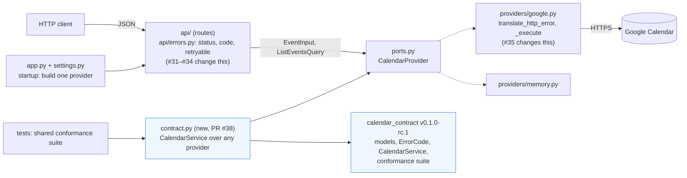

# DESIGN: BASK'D on the shared Calendar contract

| | |
| --- | --- |
| **Authors** | Arda Dinc (draft), for Team 7 |
| **Team and vertical** | Team 7 (Sam Fiallos, Arda Dinc, Bryant Luna-Ramos, Karthik Ganeshan, Daniel Zhang), Calendar vertical with Teams 2 and 5 |
| **Reviewers** | Whole design: a Team 7 member who did not write it (requested: Sam Fiallos). Contract-facing parts (§3, §4, §6, §8): Team 2 or Team 5 (requested). See [§10](#10-review-record) |
| **Status** | **In review** |
| **Last updated** | 2026-11-04 |
| **Shared contract** | [`calendar-contract` `v0.1.0-rc.1`](https://github.com/Airbus-A330/OSPSD-Calendar/tree/v0.1.0-rc.1) (commit `1c1cad7`): [HTTP contract](https://github.com/Airbus-A330/OSPSD-Calendar/blob/v0.1.0-rc.1/docs/HTTP_CONTRACT.md), [Python interface](https://github.com/Airbus-A330/OSPSD-Calendar/blob/v0.1.0-rc.1/docs/PYTHON_INTERFACE.md), [conformance suite](https://github.com/Airbus-A330/OSPSD-Calendar/blob/v0.1.0-rc.1/src/calendar_contract/conformance.py) |
| **Decision memo** | "Calendar API: joint contract (Teams 2, 5, 7)", version 4, agreed Oct 28, 2026. It is a Google Doc whose link lets anyone edit, so it is not linked from this public repository; its rules are restated, with the memo's rule numbers, in the shared repo's HTTP contract above |
| **Implementation work** | [#37](https://github.com/samthropic/BASKD/issues/37) / [PR #38](https://github.com/samthropic/BASKD/pull/38) (adopt the package, run its suite), [#31](https://github.com/samthropic/BASKD/issues/31) / [PR #36](https://github.com/samthropic/BASKD/pull/36) (shared error codes), [#32](https://github.com/samthropic/BASKD/issues/32), [#33](https://github.com/samthropic/BASKD/issues/33), [#34](https://github.com/samthropic/BASKD/issues/34), [#35](https://github.com/samthropic/BASKD/issues/35), release `v0.2.0` |

This document says how our HW1 service, BASK'D, will satisfy the contract the three Calendar
teams agreed on, and how we will know it does. It does not repeat the contract: when a rule is
cited as "rule N", the wording is in the shared HTTP contract.

## 1. Context, goals and non-goals

**What a consumer wants.** A client (a script, another team's app, the course staff's checker)
wants to create, read, replace and delete events through any of the three Calendar services
with one piece of code: the same request bodies, and the same decision about what to do when
a call fails.

**Why that is hard today.** BASK'D `v0.1.0` agrees with the contract on paths, field names and
success statuses, but not on failures, and the differences are silent:

- **A timed-out create.** When Google does not answer an `events.insert` within our timeout, we
  return `503 provider_unavailable` with `Retry-After: 5`. A client written for the contract
  reads 503 as "temporarily unavailable, try again", resends the `POST`, and can create a
  second copy of the event, because Google may have stored the first one. Rule 6 makes this
  case `502 provider_error` with `"retryable": false`. Nothing in our response tells the client
  otherwise: we do not send `retryable` at all (rule 4).
- **Error codes.** A client that branches on `code == "not_found"` never matches our
  `event_not_found`, and falls into its "unknown error" path for an ordinary missing event.
  Likewise `validation_error` and `invalid_request` versus `invalid_input` (rule 12).
- **A calendar the service cannot see.** We return `502 provider_auth_error`. A client that
  retries 5xx responses keeps retrying a configuration problem that only an operator can fix;
  the contract says `403 access_denied` (rule 9).
- **A body that is not JSON** gets our `422`; the contract says `400` (rule 3), so a client
  cannot tell its own serialisation bug from a rule it broke.

**Goals.** Each is observable from outside the service:

1. A client that uses only the shared four fields and branches only on `code` and `retryable`
   completes create → get → replace → delete against BASK'D with the same code it uses for
   Teams 2 and 5 ([§8](#8-testing), consumer workflow).
2. Every error body has `code`, `message` and `retryable`, and every failure the contract
   covers carries one of the five shared codes with the status the contract gives it.
3. A create or replace whose outcome is unknown is never reported as retryable, and the
   service never resends it on its own.
4. The package's conformance suite passes against BASK'D in every CI run, and its create, get,
   replace and delete checks pass against the real Google Calendar.
5. Our extensions keep working: listing with a window and cursor, `description`, `location`,
   the read-only `all_day` and `web_link`, and the `Location` header on create.

**Non-goals.**

- Making listing, `PATCH`, all-day events or fields beyond the shared four part of the shared
  contract (memo open question 3). They stay our documented extensions.
- Idempotent create. We raise the problem (memo open question 2, [§9](#9-open-questions)) but
  do not build it this milestone.
- Building our HTTP handlers on the shared Python models ([§5](#5-alternatives-and-tradeoffs)).
- Multiple calendars, caller identities, attendees, or moving events between calendars or
  providers. The service stays bound to one configured calendar.

## 2. Proposed architecture and request flow

The design changes two edges of the existing ports-and-adapters layout and adds one adapter.
The core (`ports.py`, `models.py`, the in-memory provider) does not change. The module-by-module
tour is in [`docs/ARCHITECTURE.md`](docs/ARCHITECTURE.md).



| Responsibility | Where | Changes in this design |
| --- | --- | --- |
| Shared contract package: shared models, the five codes, `CalendarService`, the conformance suite | `calendar_contract` (git dependency, pinned to a tag) | New dependency (PR #38) |
| Request validation (rules 2, 7, 13, 14) | `models.py` (`EventInput`, `ListEventsQuery`) | None: already follows the rules |
| HTTP translation: status, error code, `retryable`, `Retry-After`, failure log line | `api/errors.py` | Codes (#31), 403 (#32), `retryable` (#33), 400 for non-JSON (#34) |
| Application decisions (refuse to replace an all-day event or a recurring series) | `providers/google.py::replace_event` | None |
| Provider adapter: Google calls, timeout, Google error → domain error | `providers/google.py` | A write that may have happened becomes `ProviderError` (#35) |
| Domain errors (class, code, `retryable`) | `errors.py` | Codes renamed (#31) |
| Shared Python interface over our providers | `contract.py` | New (PR #38) |
| Startup configuration | `settings.py`, `providers/__init__.py::build_provider`, `app.py::create_app` | None |

**Who owns state and clients.** `create_app` builds one provider at startup from
`Settings` and keeps it on `app.state`; handlers get it through `api/dependencies.py`. The
Google provider holds the service-account credentials and the SDK's service object for the
life of the process. Each call opens its own `httplib2.Http` with the configured timeout
(`BASKD_GOOGLE_TIMEOUT_SECONDS`, default 10 s), so no connection outlives a request and there
is nothing to close at shutdown. The service keeps no event data of its own: Google is the
only store.

**Where things happen.** Validation happens once, at the boundary, in `models.py`. Domain
conversion (Google resource ↔ `Event`) is in `providers/google.py`. Error translation happens
twice, deliberately: Google → domain errors in the provider, domain errors → HTTP in
`api/errors.py` (or → shared `CalendarError` in `contract.py`). Logging happens only on failure:
one sanitised line from `api/failure_log.py` per failed request, plus one line from the Google
adapter with Google's status and `reason` codes.

**Trace 1, success: `POST /events`.**

1. FastAPI decodes the JSON body into `EventInput`. It rejects missing, `null` and unknown fields,
   timestamps without an offset, numbers, blank titles, titles over 1024 characters and an `end`
   not after `start` once sub-seconds are dropped, all with `422` and before any provider call.
2. `api/events.py::create_event` calls `provider.create_event(data)` on the `CalendarProvider`
   from `app.state`.
3. `GoogleCalendarProvider.create_event` builds the body (`to_google_body`) and runs one
   `events.insert` through `_execute` (no SDK retries: `num_retries=0`).
4. `event_from_google` turns Google's resource into an `Event` with UTC times.
5. The handler returns `201`, a `Location: /events/{id}` header and the event. Nothing is logged.

**Trace 2, expected failure: `POST /events` while Google times out, after #35.**

1–3. As above, until `events.insert` raises a socket timeout inside `_execute`.
4. Because the call is a write, `_execute` raises `ProviderError("…outcome unknown…")` instead
   of `ProviderUnavailable`. (Today it raises `ProviderUnavailable`.)
5. `api/errors.py` maps `ProviderError` to `502` with
   `{"error": {"code": "provider_error", "message": "…", "retryable": false}}` and no
   `Retry-After`. `failure_log.py` writes one `ERROR` line with the operation, status, code,
   `retryable` and request id, and no body, event id or Google text.
6. The client sees `retryable: false` and does not resend blindly ([§8](#8-testing)).

The Python path is the same, with `contract.py` in place of the handler:
`ContractCalendarService.create(CreateEvent)` validates the shared request into our
`EventInput` (so our own limits apply), calls the provider, and converts the result to the
shared `Event`. A domain error is re-raised as the shared `CalendarError` with the same message
and `retryable`.

## 3. API and data model

The authoritative contracts are the shared
[HTTP contract](https://github.com/Airbus-A330/OSPSD-Calendar/blob/v0.1.0-rc.1/docs/HTTP_CONTRACT.md)
and [Python interface](https://github.com/Airbus-A330/OSPSD-Calendar/blob/v0.1.0-rc.1/docs/PYTHON_INTERFACE.md).
Our own API is in the [README](README.md#the-api). The choices that matter:

- **Identifiers.** Google assigns the event id. It is opaque, 1–1024 characters, and scoped to
  the one calendar the service is configured with; clients never name a calendar.
- **Fields.** `title`, `start` and `end` are required on create and replace. `description` and
  `location` are optional extensions. `all_day` and `web_link` are read-only extensions.
- **Replace.** `PUT` replaces every client-editable field: the shared three, and our
  `description` and `location`, which are cleared when omitted (rule 1 leaves this to each
  team). The id never changes.
- **Times.** Requests: RFC 3339 with an offset. Responses: UTC with `Z`. Sub-seconds are dropped
  before `end > start` is checked (rule 14).
- **Failures.** The table in [§4](#4-failure-behaviour-and-operational-concerns).

**Illustrative expected exchange (after `v0.2.0`).** The success shape is what `v0.1.0`
already returns, and recorded runs are in [`TUTORIAL.md`](TUTORIAL.md). The error body is
expected, not yet observed.

```http
POST /events
Content-Type: application/json

{"title": "Team sync", "start": "2026-11-11T10:00:00-05:00", "end": "2026-11-11T10:30:00-05:00"}
```

```http
HTTP/1.1 201 Created
Location: /events/4k9v2m1q8s7d6f5g3h2j1l0p9o
X-Request-ID: 6f1c…

{"id": "4k9v2m1q8s7d6f5g3h2j1l0p9o", "title": "Team sync",
 "start": "2026-11-11T15:00:00Z", "end": "2026-11-11T15:30:00Z",
 "all_day": false, "description": null, "location": null,
 "web_link": "https://www.google.com/calendar/event?eid=…"}
```

```http
HTTP/1.1 502 Bad Gateway

{"error": {"code": "provider_error",
           "message": "The calendar provider did not answer; the event may or may not have been created",
           "retryable": false}}
```

At implementation time we will replace the error example with an observed, sanitised response
and the command that produced it.

**Translations that lose information or narrow a capability.**

| What | Effect | Why we accept it |
| --- | --- | --- |
| The request's UTC offset | Responses are always UTC | Rule 2 guarantees the instant, not the offset |
| Sub-seconds | Dropped on the way in | Google stores whole seconds (rule 14) |
| All-day events through the Python interface | The shared `Event` has no `all_day`, so `contract.py` returns midnight-UTC bounds without the flag | Over HTTP we keep `all_day`; the shared core has no all-day events |
| A provider event that ends when it starts | Readable over HTTP; through `contract.py` it is `provider_error`, because the shared `Event` requires `end > start` | We raised this on the shared package ([§9](#9-open-questions)) |
| An untitled provider event | Read with `"title": ""` | Rule 13: a server never invents a title |
| Attendees | Not offered | A service account cannot invite without domain-wide delegation |
| Replacing an all-day event or a recurring series | Refused with `400 invalid_input`, event unchanged | Google would silently turn it into a timed event |

**HW1 operations and the shared API.**

| HW1 operation | Shared contract |
| --- | --- |
| `POST /events`, `GET /events/{id}`, `PUT /events/{id}`, `DELETE /events/{id}` | Shared core; same paths and success statuses as the contract already |
| `GET /events?from=&to=&limit=&cursor=` | Our extension (listing is not shared) |
| `description`, `location`, `all_day`, `web_link`, `Location` header | Our extensions |
| `GET /health` | Outside the contract |

## 4. Failure behaviour and operational concerns

**From provider outcome to HTTP response, after `v0.2.0`.** Rows marked ★ change in this design.

| Google outcome | Domain error (`errors.py`) | HTTP | `code` | `retryable` |
| --- | --- | --- | --- | --- |
| Body breaks a rule (we never call Google) | validation | 422 | `invalid_input` | false |
| ★ Body is not valid JSON (#34) | validation | 400 (was 422) | `invalid_input` | false |
| 400 from Google; all-day or series replace; bad cursor | `InvalidRequest` | 400 | `invalid_input` | false |
| 404 or 410 on get/replace/delete, or a `cancelled` event | `EventNotFound` | 404 | `not_found` | false |
| ★ 401, 403 (not quota), refused credentials, or 404 on create/list (calendar not shared) (#32) | `ProviderAuthError` | 403 (was 502) | `access_denied` | false |
| 429, 5xx, or a 403 quota reason, on a read or delete | `ProviderUnavailable` | 503 + `Retry-After: 5` | `provider_unavailable` | true |
| Timeout or network error on a read or delete | `ProviderUnavailable` | 503 + `Retry-After: 5` | `provider_unavailable` | true |
| ★ Timeout or network error on a create or replace (#35) | `ProviderError` | 502 (was 503) | `provider_error` | false (was true) |
| Any other Google response | `ProviderError` | 502 | `provider_error` | false |

Every row gains a `retryable` field in the body (#33); today only the error classes carry it.
Whether a Google 5xx on a create or replace also means "outcome unknown" is open
([§9](#9-open-questions)).

**Retries.** The service retries nothing: the Google SDK runs with `num_retries=0`. For reads
and delete, retrying is safe, but the client decides, guided by `retryable` and `Retry-After`.
For create, retrying is not safe, because `events.insert` is not idempotent and a timed-out
insert may have succeeded (rule 6). For replace, a repeat would usually be harmless, but the
contract treats both writes the same, and so do we.

**Configuration and credentials.** All settings are `BASKD_*` environment variables or `.env`
(`settings.py` fails fast at startup when the Google provider lacks a calendar id or a key).
The service-account key is a file path or, in CI, a repository secret; it is never committed.
The service can reach only the one calendar shared with its service account.

**Data exposure.** Error messages are our own; Google's error text never reaches a client.
Failure logs carry no request or response body, query string, event id, header, credential or
Google text. `contract.py` keeps that rule: `invalid_input` details name the field and the rule,
and never echo the input.

**Limits and cleanup.** Title ≤ 1024, description ≤ 8192, location ≤ 1024 characters; id 1–1024;
list `limit` 1–250; Google timeout 10 s. Google's per-project quota surfaces as `503`. Every live
test deletes what it creates. A create that timed out may leave an event that only the client
can find (with our listing) and delete.

**Fast and live tests stay separate.** `make check` uses the in-memory provider and a fake
Google SDK; only `-m integration` tests touch Google, and they skip without credentials.

**Cost of the affected operations.** The redesign changes no provider calls. Create, get and
delete are one Google call each (`events.insert`, `events.get`, `events.delete`); replace is two
(`events.get`, to refuse all-day events and series, then `events.update`). Local work is
validating one small body and converting one resource. Through `contract.py` there is one more
model conversion each way, still constant-size. [`docs/COST.md`](docs/COST.md) covers listing,
which this design does not change, so it stays accurate. We do not infer Google's internal
work from latency.

**Tools and hosting.** CI is GitHub Actions ([`ci.yml`](.github/workflows/ci.yml)); the image is
built from our [`Dockerfile`](Dockerfile), whose builder stage now needs `git` and access to
github.com for the shared package (PR #38). [`docs/DEPLOYMENT.md`](docs/DEPLOYMENT.md) describes
Docker and an example Cloud Run deployment with the key in Secret Manager. The Milestone 3
choices (host, the person who owns each account, expected cost, teardown date) are an open item
in [§9](#9-open-questions).

## 5. Alternatives and tradeoffs

### Decision A: adapt our model at the edges, or replace it with the shared one

**Chosen: keep our models and port; adapt at two edges.** HTTP keeps our `EventInput` and
`Event`, and `api/errors.py` is changed to produce the contract's statuses and codes.
`contract.py` presents the same providers through the shared `CalendarService` so the shared
suite can run against them.

**Alternative: build the handlers on the shared package.** `api/` would accept `CreateEvent` and
`ReplaceEvent`, call a `CalendarService`, and return the shared `Event`.

| | Adapt at the edges (chosen) | Build on the shared models |
| --- | --- | --- |
| Our extensions | Unchanged | `description` and `location` break: the shared request models forbid unknown fields, so our clients would get `422`. Listing is not in `CalendarService`, so it would bypass the interface anyway |
| Provider events the shared `Event` rejects (end = start) | Still readable over HTTP | `GET` would fail with `502` for an event Google stores |
| Error mapping | Exists twice (`api/errors.py`, `contract.py`), both keyed on the same domain classes | Once |
| Effect on Teams 2 and 5 | None | None |
| Size of change | `contract.py` (130 lines) and tests; the HTTP changes are the five issues | Rewrite of `api/events.py`, `models.py` and their tests |

The evidence is PR #38: with `contract.py`, the shared suite passes on the in-memory provider,
on the Google adapter over a fake SDK, and on the real Google Calendar, with no HTTP change.
The cost is the duplicated mapping; a test parametrised over every domain error class checks
it. **We would revisit** if the shared package gains an HTTP conformance suite or shared
extensions (listing, optional fields), or if something at runtime needs the Python interface.
Then one translator, used by `api/` too, would pay for itself.

### Decision B: what to do with a write whose outcome is unknown

**Chosen: report it (`502`, `retryable: false`) and never retry.** This is rule 6, and it is
the same at all three services.

**Alternative: make create safely retryable.** Google lets the caller choose the id of a new
event: per the Calendar API's Events reference, a client-supplied id must be 5–1024 base32hex
characters and unique in the calendar, and inserting an id that already exists fails. The
service could choose the id, retry once after a timeout, and treat "already exists" as success
by reading the event back. The client would get a definite answer instead of "unknown".
We did not prototype this, and it is our reading of the documentation, not a measured result.
It would break rule 6 ("never retries the write on its own") unless the three teams change the
contract, and Teams 2 and 5 would need the same change for clients to rely on it. Clients would
need to know it is our extension. We keep it as our proposal for memo open question 2.

## 6. Migration and coordination plan

**Package revision.** We adopt `calendar-contract` `v0.1.0-rc.1` (commit `1c1cad7`) as a git
dependency pinned by tag in `pyproject.toml`, and `uv.lock` pins the commit. `rc.1` is marked
"Latest" on GitHub rather than pre-release and its metadata says `0.1.0`; we pin the commit, so
that does not affect us. Moving to the next tag is a one-line change plus `uv lock`
([`AGENTS.md`](AGENTS.md) §6 lists the steps).

**What changes in our repository.**

- Code: `contract.py` (new), `errors.py`, `api/errors.py`, `api/events.py`, `api/cursors.py`,
  `api/failure_log.py`, `providers/google.py::_execute`.
- Tests: every test asserting a code or status (`test_api_errors`, `test_api_events`,
  `test_failure_logging`, `test_get_contract`, `test_memory_provider`, `test_google_provider`,
  `tests/integration/test_google_calendar.py`), plus the new conformance modules.
- Docs and examples: README API and error tables, `docs/ARCHITECTURE.md`, `docs/REQUIREMENTS.md`,
  `docs/DECISIONS.md` (we argued for 502 on a denial and record why we moved to 403),
  `docs/HUMAN_STEPS.md`, a note in `TUTORIAL.md` that its demos were recorded on `v0.1.0`.
- Configuration: none for users. The Docker builder needs `git`.

**Compatibility for existing callers.** Renamed codes and changed statuses break any client that
branches on them, so they ship together as `v0.2.0`, a minor bump under `AGENTS.md` §5, listed
under "Breaking changes" in `CHANGELOG.md` and announced to the team before merging. Success
responses and our extensions do not change, so a client that only handles success is
unaffected.

**Order of the work.** Owners and checkpoints are in [§11](#11-actions).

1. PR #38 adopts the package and runs its suite, against fakes and against real Google. This
   was our **early end-to-end step**, and it is done: on Nov 4 the suite's 10 create, get,
   replace and delete checks passed through `v0.1.0-rc.1` against our Google test calendar.
2. PR #36 (#31) renames the codes. #32, #33 and #34 build on it; #35 builds on #33.
3. #35 turns the strict expected failure in the conformance suite into an unexpected pass, which
   fails CI until the `xfail` is removed. That is how we know the last rule is met.
4. `v0.2.0` is released by a coordinator other than the last two (`AGENTS.md` §5), with a
   fresh-checkout verification by someone else.
5. Milestone 3: the consumer workflow in [§8](#8-testing) runs against our deployed service.

**An incompatible change to the contract after teams have started.** Every team's service and
every client of those services is affected. The shared repository's
[`RELEASING.md`](https://github.com/Airbus-A330/OSPSD-Calendar/blob/v0.1.0-rc.1/docs/RELEASING.md)
covers it: a contract change bumps the minor version, the release PR needs one approval from
each of Teams 2, 5 and 7, a version to try first is published as a pre-release, tags are never
moved, and the release is announced on the joint email thread and in `#calendar`. On our side we
stay on the old tag until our suite passes on the new one, and a change that breaks our own
clients gets its own minor release of BASK'D.

## 7. How the shared suite runs against BASK'D

The package ships `CalendarServiceConformance`. A team subclasses it and supplies two fixtures:
`service` (the implementation under test) and `failing_service` (a factory that returns one
failing the way a `ProviderFailure` describes).

| Module | `service` | `failing_service` | Runs in |
| --- | --- | --- | --- |
| [`tests/unit/test_contract_conformance.py`](tests/unit/test_contract_conformance.py) (PR #38) | `ContractCalendarService(InMemoryCalendarProvider())` | Our real `GoogleCalendarProvider` on the fake SDK: access denied is a 403 `HttpError`, an unexpected response a 409, unavailable a 503, an uncertain write a `TimeoutError` | `make check`, every CI run |
| [`tests/integration/test_contract_google.py`](tests/integration/test_contract_google.py) (PR #38) | `ContractCalendarService` on `GoogleCalendarProvider.from_settings(Settings())` | Skipped: a real calendar cannot fail on demand | `make test-integration`, CI when secrets are present |

**Test data.** The suite's `created_ids` fixture deletes every event a test created, and
`missing_id` creates an event and deletes it to get an id that is known to be gone. Each test
touches only its own events, so runs on the shared test calendar do not interfere.

**What a mismatch looks like.** If we mapped a Google 403 to anything but `access_denied`,
`test_access_denied_raises_access_denied` would fail. If a repeated delete returned success,
`test_delete_missing_event_raises_not_found` would. The uncertain-write check is a strict
expected failure today (#35), so it shows up in every run until it is fixed.

## 8. Testing

**Guarantees and the checks that establish them.**

| Guarantee | Check | Kind |
| --- | --- | --- |
| Create, get, replace and delete behave as the contract says, including 404 for a missing or deleted event | Shared suite on the in-memory provider and on real Google | Controlled and live |
| Google failures become the shared codes through our real translation code | Shared suite's failure checks on the Google adapter over the fake SDK | Controlled |
| An uncertain write is `provider_error`, not retryable | Shared suite, strict `xfail` until #35; `test_google_provider.py` after #35 | Controlled |
| Each domain error keeps its message and `retryable` through `contract.py` | `TestContractCalendarService` | Controlled |
| HTTP statuses, codes, `retryable` and body shape (rules 3, 4, 9, 12) | `test_api_errors.py`, `test_api_events.py` through the FastAPI `TestClient` | HTTP boundary |
| Request rules (rules 2, 7, 13, 14) | `test_models.py`, `test_api_events.py::TestCreate` | HTTP boundary |
| Google's 404/410/`cancelled` and "calendar not shared" are told apart | `test_google_provider.py::TestTranslateHttpError` | Controlled |
| Failure logs never contain bodies, ids or provider text | `test_failure_logging.py` | Controlled |
| Provider assumptions: Google returns `cancelled` or 410 after a delete, denies an unshared calendar, stores whole seconds | `tests/integration/test_google_calendar.py`, `test_contract_google.py` | Live |

**Gaps, named.** The shared suite checks the Python interface, not HTTP. Our HTTP behaviour is
checked by our own tests against our reading of the contract, and nothing yet checks that the
three services answer the same HTTP request the same way. The uncertain-write case cannot be
checked live. The consumer workflow below has not run against any deployed service yet.

**Consumer workflow.** The same code runs against any conforming service. It branches only on
success, `code` and `retryable`, and it never resends a write that is not retryable:

```python
import time
import httpx


def call(method: str, url: str, body: dict | None = None) -> dict | None:
    for _ in range(3):
        response = httpx.request(method, url, json=body, timeout=15)
        if response.is_success:
            return response.json() if response.content else None
        error = response.json()["error"]
        if not error["retryable"]:
            raise RuntimeError(f"{response.status_code} {error['code']}: {error['message']}")
        time.sleep(int(response.headers.get("Retry-After", "1")))
    raise RuntimeError("still unavailable after 3 tries")


def workflow(base: str) -> None:
    body = {"title": "Team sync", "start": "2026-11-11T15:00:00Z", "end": "2026-11-11T15:30:00Z"}
    event = call("POST", f"{base}/events", body)
    assert call("GET", f"{base}/events/{event['id']}")["title"] == "Team sync"
    moved = {**body, "start": "2026-11-11T16:00:00Z", "end": "2026-11-11T16:30:00Z"}
    assert call("PUT", f"{base}/events/{event['id']}", moved)["id"] == event["id"]
    call("DELETE", f"{base}/events/{event['id']}")
```

A `POST` that fails with `retryable: false` stops the workflow instead of creating a duplicate.
We will commit this as a script and run it against our deployed service in Milestone 3, and
against Teams 2 and 5 when their services are reachable.

**Concerns raised so far.**

| Concern | Outcome |
| --- | --- |
| A permission denial: 502 (our HW1 choice, since the service and not the caller is denied) or 403 | Accepted 403 so the contract could settle; recorded in `docs/DECISIONS.md` in #32 |
| The shared `v0.1.0-rc.1` was published as "Latest", not pre-release, without a release PR | Raised in our review of shared PR #14. Accepted risk: we pin the commit |
| Which codes are retryable is not stated per code in the package | Raised on shared PR #14; we follow the error classes and the memo |
| The shared `Event` rejects an event whose end is not after its start, which Google can store | Deferred: [§9](#9-open-questions), question 3 |

## 9. Open questions

| # | Question | Consequence | Owner | Next step |
| --- | --- | --- | --- | --- |
| 1 | Is a Google 5xx on a create or replace "outcome unknown" (502, not retryable) or "unavailable" (503, retryable)? | A retried create could duplicate an event | Karthik (proposed owner of #35) | Decide in the #35 PR; we lean to "unknown", the safer answer |
| 2 | Memo question 2: after a timed-out create, the shared core gives a client no way to check whether the event exists | Clients of Team 5 (no listing) cannot recover; ours can only by listing | Arda | Open an issue on the shared repository with decision B's alternative, before the Nov 11 checkpoint |
| 3 | The shared `Event`, and the HTTP contract's wording for response events, require `end > start`, but rule 2 requires it only of requests | A valid Google event cannot be read through the shared interface | Arda | Open a wording PR on the shared repository (promised in our review of PR #14) |
| 4 | Nobody owns an HTTP-level conformance suite for the vertical | HTTP differences between the three services are caught only by each team's own tests | Unassigned across the three teams | Raise at the next joint checkpoint |
| 5 | Milestone 3 hosting: which platform, who owns the account, expected cost, teardown date | Required by Milestone 3 | To assign at the next team meeting | Record the choice here and in `docs/DEPLOYMENT.md` |
| 6 | The memo cannot be linked from public repositories because its link grants edit access | Readers of this document cannot open the memo | Arda | Publish a read-only copy and link it in the header |

## 10. Review record

| Reviewer | Scope | Where | Result |
| --- | --- | --- | --- |
| Team 7 member (requested: Sam Fiallos) | Whole document | The PR that adds this file | Pending |
| Team 2 or Team 5 member | §3, §4, §6 (contract change process), §8 (consumer workflow) | The same PR | Pending |

Substantive comments are answered in the PR with a change or a reason, and the outcome is added
to the "Concerns raised so far" table. Approval here accepts the plan, not the implementation.

## 11. Actions

Owners marked "proposed" have not confirmed yet.

| Action | Owner | Output | Depends on | Checkpoint |
| --- | --- | --- | --- | --- |
| Adopt the package; run its suite on fakes and on real Google | Arda | PR #38 merged | Two reviews (dependency and Dockerfile change) | Nov 4 (PR open, live run passed) |
| Rename the error codes | Arda | PR #36 merged (#31) | Review | Nov 11 |
| 403 `access_denied` for a denial | Dan (proposed) | #32 | #31 | Nov 11 |
| `retryable` in every error body | Bryant (proposed) | #33 | #31 | Nov 11 |
| 400 for a body that is not JSON | Sam (proposed) | #34 | #31 | Nov 11 |
| 502, not retryable, for an uncertain write; remove the `xfail` | Karthik (proposed) | #35 | #33 | Nov 11 |
| Release `v0.2.0` with a fresh-checkout verification | Sam, Bryant or Karthik (coordinator, to choose) | GitHub Release | #31–#35, #37 | Nov 11 |
| Shared-repo issue for memo question 2; wording PR for question 3 | Arda | Issue and PR on the shared repo | None | Nov 11 |
| Consumer workflow script, run against the deployed service | To assign | Script in `scripts/` and a recorded run | `v0.2.0`, hosting (question 5) | Nov 11 |
| Update this document where the implementation changes the plan | Whoever changes the plan | Edits to this file, with a line below | | Each PR |

## Revision history

- 2026-11-04: first version, for the Milestone 2 review (Arda). Issue #39.
