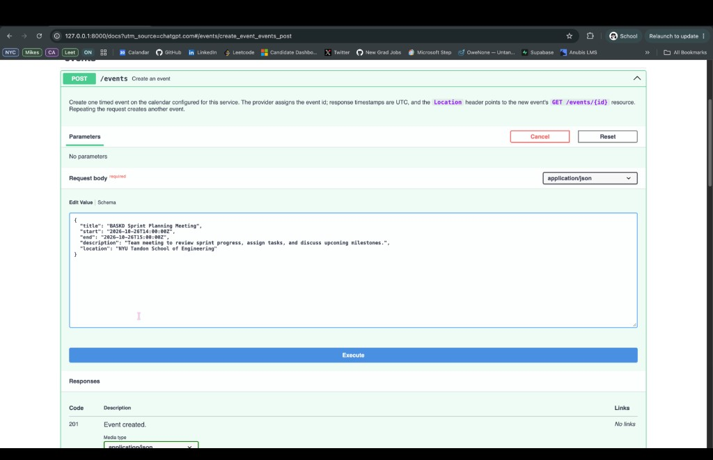
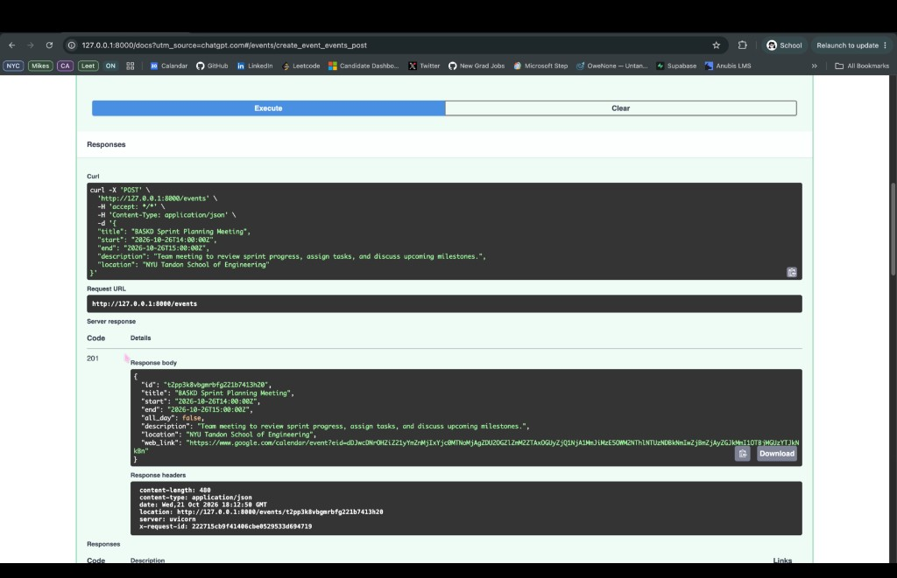
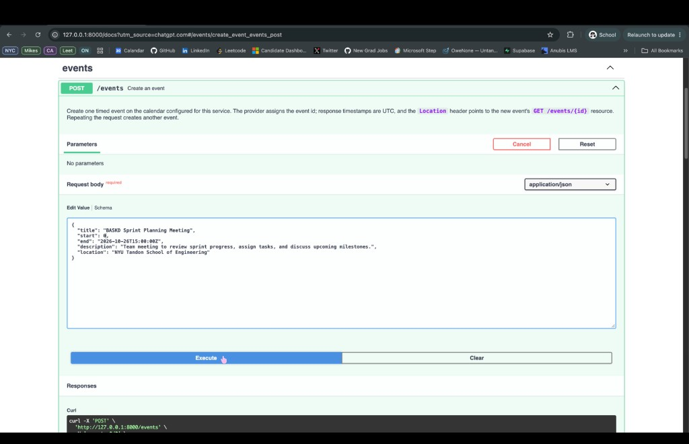
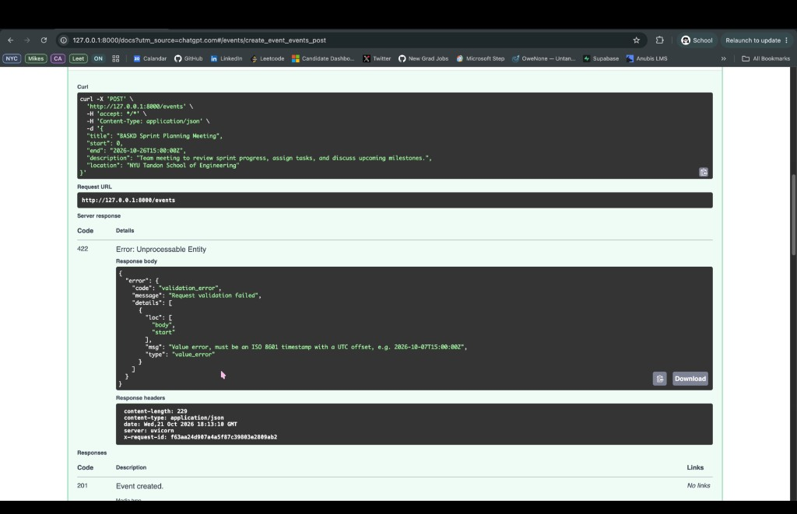
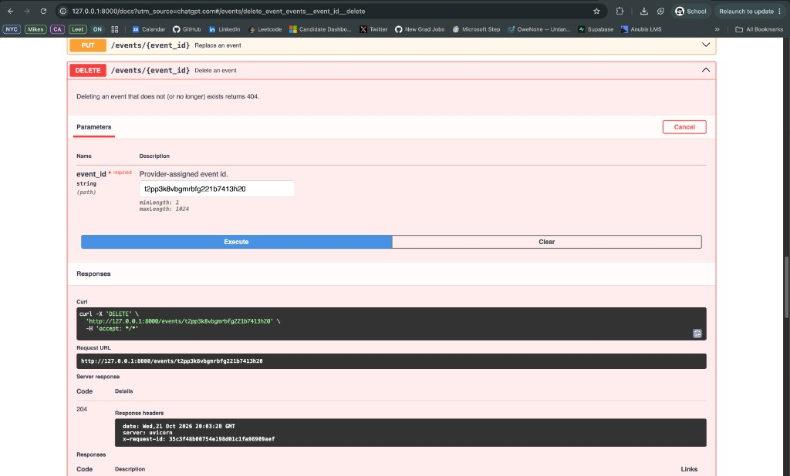
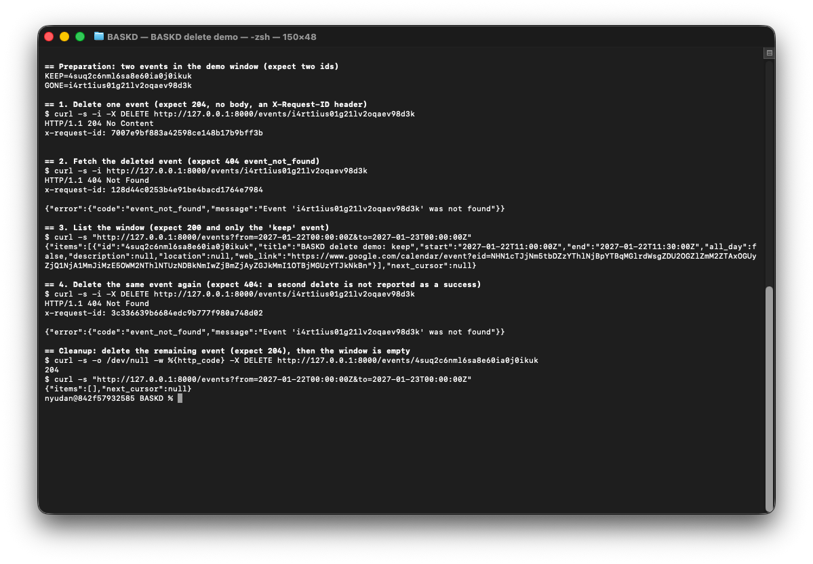
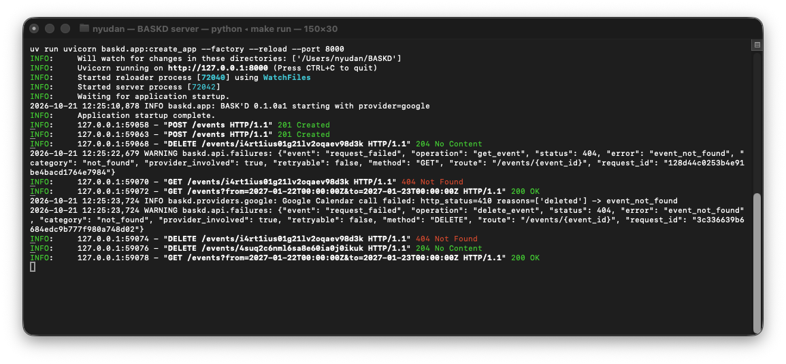

# BASK'D demo: the workflow against Google Calendar

Each section is one operation, run by its owner against the real Google Calendar through
`curl` or the interactive docs at `/docs`, with screenshots of what actually came back.
Every step says what we expected, then shows what actually came back.

Setup for every section: configure `.env` as in [`docs/HUMAN_STEPS.md`](docs/HUMAN_STEPS.md),
then `make run` in one terminal (the service listens on `http://127.0.0.1:8000`) and run the
commands in a second one. `curl -s http://127.0.0.1:8000/health` should report
`"provider":"google"`.

## Create an event: `POST /events`

Owner: Sam Fiallos. I ran this against our real Google calendar through the interactive docs
at `http://127.0.0.1:8000/docs` on 21 Oct 2026, on macOS. The `201` body includes a Google
`web_link`, and both responses carry `X-Request-ID`.

**What this shows:** creating one timed event returns `201`, a `Location` header for
`GET /events/{id}`, and the event Google stored. Sending a number for `start` (`0`) is
refused with `422 validation_error`, and Google is not called.

### 1. Create one timed event

**Expected:** `201`, a `Location` header pointing at the new `GET /events/{id}` resource,
and a body whose `id` Google assigned. `start` and `end` come back as the UTC timestamps
we sent, `all_day` is `false`, description and location are echoed, and `web_link` is set.

```bash
API=http://127.0.0.1:8000
curl -s -i $API/events -H 'Content-Type: application/json' \
  -d '{"title":"BASKD Sprint Planning Meeting","start":"2026-10-20T14:00:00Z","end":"2026-10-20T15:00:00Z","description":"Team meeting to review sprint progress, assign tasks, and discuss upcoming milestones.","location":"NYU Tandon School of Engineering"}'
```

The same body in the docs UI, before Execute:





**Actual:** as expected. Google assigned `t2pp3k8vbgmrbfg221b7413h20`. `Location` is
`http://127.0.0.1:8000/events/t2pp3k8vbgmrbfg221b7413h20`. Times came back unchanged and in
UTC, `all_day` is `false`, and `web_link` opens the event in Google Calendar.
`X-Request-ID: 222715c60f41406cbe0529533d694719`.

### 2. Failure: a numeric timestamp

**Expected:** `422` with `{"error": {"code": "validation_error", ...}}`. `start` must be an
ISO 8601 string with an offset; a number is not guessed as Unix time. Validation runs
before the provider is called, so Google never sees this body. `details` names
`body.start` and does not echo the bad value.

```bash
curl -s -i $API/events -H 'Content-Type: application/json' \
  -d '{"title":"BASKD Sprint Planning Meeting","start":0,"end":"2026-10-20T15:00:00Z","description":"Team meeting to review sprint progress, assign tasks, and discuss upcoming milestones.","location":"NYU Tandon School of Engineering"}'
```





**Actual:** as expected. `details[0].loc` is `["body", "start"]` and the message is
"Value error, must be an ISO 8601 timestamp with a UTC offset, e.g. 2026-10-07T15:00:00Z".
`X-Request-ID: f63aa24d907e4a5f87c39083e2809ab2`.

### Cleanup

The invalid body created nothing. Delete the event from step 1.

**Expected:** `204 No Content`, no body, and an `X-Request-ID` header.

```bash
curl -s -i -X DELETE "$API/events/t2pp3k8vbgmrbfg221b7413h20"
```



**Actual:** as expected. `204` for `t2pp3k8vbgmrbfg221b7413h20`, empty body.
`X-Request-ID: 35c3f40b0d754e190d01c1fa90809aef`.

## List events: `GET /events`

I ran this against our real Google calendar (`provider: google` in `/health`) on commit `3153e3b`.

**What this shows:** listing a time window one page at a time, following `next_cursor` to
the end, and the service refusing a cursor that is reused with a different window.

**Preparation.** Create three events in an otherwise empty window on Jan 15, 2027 (09:00,
11:00 and 13:00 UTC, 30 minutes each), so the listing has a known answer:

```bash
API=http://127.0.0.1:8000
W='from=2027-01-15T00:00:00Z&to=2027-01-16T00:00:00Z'
for h in 09 11 13; do
  curl -s $API/events -H 'Content-Type: application/json' \
    -d "{\"title\":\"BASKD list demo $h:00\",\"start\":\"2027-01-15T$h:00:00Z\",\"end\":\"2027-01-15T$h:30:00Z\"}"; echo
done
```

### 1. First page

**Expected:** `200`, exactly one event (the earliest, 09:00), and a non-null `next_cursor`
because two more events match.

```bash
curl -s -i "$API/events?$W&limit=1"
```


**Actual:** as expected. To keep the cursor for the next step without copying it by hand:

```bash
C1=$(curl -s "$API/events?$W&limit=1" | python3 -c 'import json,sys;print(json.load(sys.stdin)["next_cursor"])')
```

### 2. Next page

**Expected:** `200`, the 11:00 event, and another cursor.

```bash
curl -s -i "$API/events?$W&limit=1&cursor=$C1"
C2=$(curl -s "$API/events?$W&limit=1&cursor=$C1" | python3 -c 'import json,sys;print(json.load(sys.stdin)["next_cursor"])')
```


**Actual:** as expected.

### 3. Last page

**Expected:** `200`, the 13:00 event, and `next_cursor: null`. Null is the only signal that the
listing is finished; a short page on its own is not.

```bash
curl -s -i "$API/events?$W&limit=1&cursor=$C2"
```


**Actual:** as expected. Three pages, three events, in start order.

### 4. Failure: a cursor reused with another window

**Expected:** `400 invalid_request`. A cursor only continues the listing it came from;
continuing with a different `from` would silently mix two listings. This is checked before
Google is called, so nothing is fetched.

```bash
curl -s -i "$API/events?from=2027-01-15T10:00:00Z&to=2027-01-16T00:00:00Z&limit=1&cursor=$C2"
```


**Actual:** as expected. The server log shows the whole run: the three creates (`201`), the
pages (`200`, each fetched once for the screenshot and once to save the cursor) and the
refused request (`400`, last line). Above it, `make test-integration` passing against Google
on the same checkout:


### Cleanup

Delete the events in the demo window (it was empty before), then confirm it is empty again:

```bash
curl -s "$API/events?$W" | python3 -c 'import json,sys;[print(e["id"]) for e in json.load(sys.stdin)["items"]]' \
  | while read id; do curl -s -o /dev/null -w "deleted $id -> %{http_code}\n" -X DELETE "$API/events/$id"; done
curl -s "$API/events?$W"
```


This run predates [#20](https://github.com/samthropic/BASKD/pull/20), so the responses have
no `X-Request-ID` header yet. After #20 merges, step 4 also returns one, and the server logs a
`request_failed` line with `"provider_involved": false`.

## Delete an event: `DELETE /events/{id}`

Owner: Daniel Zhang. I ran this against our real Google calendar (`provider: google` in
`/health`) on commit `ff63863` (includes #20, so responses carry `X-Request-ID`), on macOS.

**What this shows:** deleting one event removes it and nothing else; a deleted event can no
longer be fetched; deleting it a second time is reported honestly as `404`, not as a success.

The whole run is scripted in [`docs/demo/delete-demo.sh`](docs/demo/delete-demo.sh) so
anyone can repeat it: `bash docs/demo/delete-demo.sh` with the server running. The commands
below are what it executes.

**Preparation.** Two events in an otherwise empty window on Jan 22, 2027: one to delete
(10:00 UTC) and one to keep (11:00 UTC), so we can show that deletion is precise.

```bash
API=http://127.0.0.1:8000
W='from=2027-01-22T00:00:00Z&to=2027-01-23T00:00:00Z'
KEEP=$(curl -s $API/events -H 'Content-Type: application/json' \
  -d '{"title":"BASKD delete demo: keep","start":"2027-01-22T11:00:00Z","end":"2027-01-22T11:30:00Z"}' \
  | python3 -c 'import json,sys;print(json.load(sys.stdin)["id"])')
GONE=$(curl -s $API/events -H 'Content-Type: application/json' \
  -d '{"title":"BASKD delete demo: delete me","start":"2027-01-22T10:00:00Z","end":"2027-01-22T10:30:00Z"}' \
  | python3 -c 'import json,sys;print(json.load(sys.stdin)["id"])')
```

### 1. Delete one event

**Expected:** `204 No Content`, no body, and an `X-Request-ID` header.

```bash
curl -s -i -X DELETE "$API/events/$GONE"
```

### 2. Fetch the deleted event

**Expected:** `404` with `{"error": {"code": "event_not_found", ...}}`. Google answers this
`GET` with the event marked `cancelled`; the service reports it as not found rather than
returning a ghost event.

```bash
curl -s -i "$API/events/$GONE"
```

### 3. List the window

**Expected:** `200` and exactly one item, the "keep" event. Deleting one event did not touch
its neighbour.

```bash
curl -s "$API/events?$W"
```

### 4. Delete the same event again

**Expected:** `404 event_not_found`. Google answers the second delete with `410 Gone`; we
translate that to the same `404` as step 2 instead of pretending the delete succeeded, so a
caller retrying a `DELETE` can tell "already gone" from "done just now".

```bash
curl -s -i -X DELETE "$API/events/$GONE"
```

### Cleanup

**Expected:** `204` for the remaining event, then `{"items": [], "next_cursor": null}`.

```bash
curl -s -o /dev/null -w '%{http_code}\n' -X DELETE "$API/events/$KEEP"
curl -s "$API/events?$W"
```



**Actual:** every step as expected. The server log for the same run shows the two `201`s,
the `204`, and for each `404` one `request_failed` line with `"operation"`, `"category":
"not_found"`, `"provider_involved": true` and the same `request_id` the client received.
The Google adapter's own line shows the raw provider answer behind step 4:
`http_status=410 reasons=['deleted'] -> event_not_found`.


