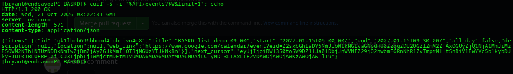
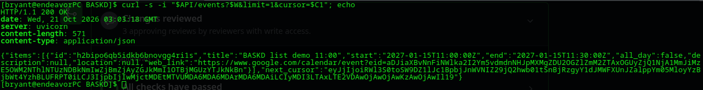
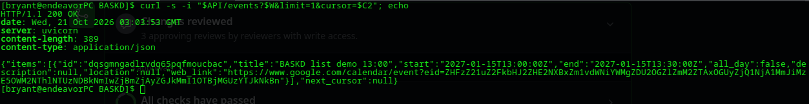
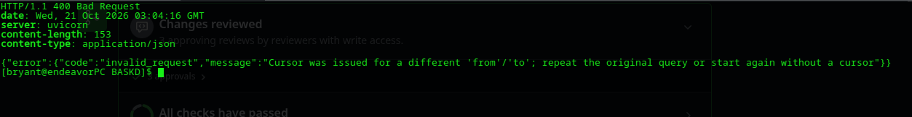
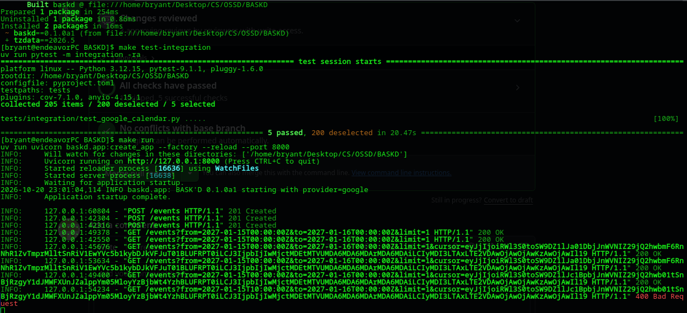
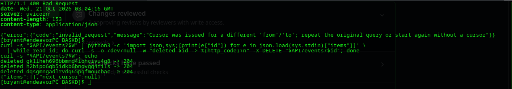

# BASK'D demo: the workflow against Google Calendar

Each section is one operation, run by its owner against the real Google Calendar through
`curl`, with screenshots of the real terminal. Every step says what we expected, then shows
what actually came back.

Setup for every section: configure `.env` as in [`docs/HUMAN_STEPS.md`](docs/HUMAN_STEPS.md),
then `make run` in one terminal (the service listens on `http://127.0.0.1:8000`) and run the
commands in a second one. `curl -s http://127.0.0.1:8000/health` should report
`"provider":"google"`.

## List events: `GET /events` (Bryant Luna-Ramos)

Run on 2026-10-20 at 23:02 ET, Linux, provider `google`, at `ce9b5f8` (`arda/milestone-1` at `3153e3b` plus this docs change; no code differences).

**What this shows:** listing a time window one page at a time, following `next_cursor` to
the end, and the service refusing a cursor that is reused with a different window.

**Preparation.** Create three events in an otherwise empty window on Jan 15, 2027 (09:00,
11:00 and 13:00 UTC, 30 minutes each), so the listing has a known answer:

```bash
API=http://127.0.0.1:8000
W='from=2027-01-15T00:00:00Z&to=2027-01-16T00:00:00Z'
for h in 09 11 13; do
  curl -s $API/events -H 'Content-Type: application/json' \
    -d "{\"title\":\"BASKD list demo $h:00\",\"start\":\"2027-01-15T$h:00:00Z\",\"end\":\"2027-01-15T$h:30:00Z\"}"; echo
done
```

### 1. First page

**Expected:** `200`, exactly one event (the earliest, 09:00), and a non-null `next_cursor`
because two more events match.

```bash
curl -s -i "$API/events?$W&limit=1"
```



**Actual:** as expected. To keep the cursor for the next step without copying it by hand:

```bash
C1=$(curl -s "$API/events?$W&limit=1" | python3 -c 'import json,sys;print(json.load(sys.stdin)["next_cursor"])')
```

### 2. Next page

**Expected:** `200`, the 11:00 event, and another cursor.

```bash
curl -s -i "$API/events?$W&limit=1&cursor=$C1"
C2=$(curl -s "$API/events?$W&limit=1&cursor=$C1" | python3 -c 'import json,sys;print(json.load(sys.stdin)["next_cursor"])')
```



**Actual:** as expected.

### 3. Last page

**Expected:** `200`, the 13:00 event, and `next_cursor: null`. Null is the only signal that the
listing is finished; a short page on its own is not.

```bash
curl -s -i "$API/events?$W&limit=1&cursor=$C2"
```



**Actual:** as expected. Three pages, three events, in start order.

### 4. Failure: a cursor reused with another window

**Expected:** `400 invalid_request`. A cursor only continues the listing it came from;
continuing with a different `from` would silently mix two listings. This is checked before
Google is called, so nothing is fetched.

```bash
curl -s -i "$API/events?from=2027-01-15T10:00:00Z&to=2027-01-16T00:00:00Z&limit=1&cursor=$C2"
```



**Actual:** as expected. The server log shows the whole run: the three creates (`201`), the
pages (`200`, each fetched once for the screenshot and once to save the cursor) and the
refused request (`400`, last line). Above it, `make test-integration` passing against Google
on the same checkout:



### Cleanup

Delete the events in the demo window (it was empty before), then confirm it is empty again:

```bash
curl -s "$API/events?$W" | python3 -c 'import json,sys;[print(e["id"]) for e in json.load(sys.stdin)["items"]]' \
  | while read id; do curl -s -o /dev/null -w "deleted $id -> %{http_code}\n" -X DELETE "$API/events/$id"; done
curl -s "$API/events?$W"
```



This run predates [#20](https://github.com/samthropic/BASKD/pull/20), so the responses have
no `X-Request-ID` header yet. After #20 merges, step 4 also returns one, and the server logs a
`request_failed` line with `"provider_involved": false`.
